<div align="center">

<a href="https://food.bababuilds.com">
  <picture>
    <source media="(prefers-color-scheme: dark)" srcset="public/brand/logos/logo-horizontal-dark.svg">
    
  </picture>
</a>

### The restaurant platform that starts free and grows with you.

Digital menus and **permanent QR codes, free forever** — then live table ordering, a kitchen display and a native POS when you're ready.

<br>

[](https://food.bababuilds.com)
[](docs/demo.md)
[](#-documentation)

[](https://github.com/baba-dev/menuminute/actions/workflows/ci.yml)


[](LICENSE)

**[Why MenuMinute](#-why-menuminute) · [Features](#-features) · [Screenshots](#-take-a-look) · [Plans](#-plans) · [Quick start](#-quick-start) · [Architecture](#-architecture) · [Docs](#-documentation) · [Contributing](#-contributing)**

<br>

<picture>
  <source media="(prefers-color-scheme: dark)" srcset="public/docs-media/dashboard-desktop-dark.webp">
  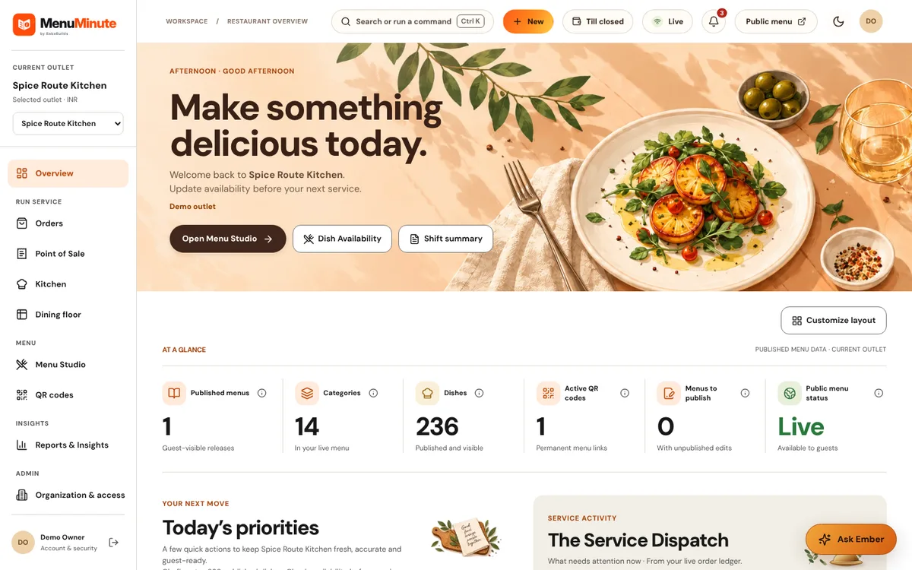
</picture>

</div>

---

## ✨ Why MenuMinute

Most restaurant software makes you pay before you see any value. MenuMinute flips that.

| 🆓 **Free forever**                                                                                                                   | 📱 **Mobile-first**                                                                                                  | 🧱 **One platform**                                                                                 |
| :------------------------------------------------------------------------------------------------------------------------------------ | :------------------------------------------------------------------------------------------------------------------- | :-------------------------------------------------------------------------------------------------- |
| Build a full menu and print a permanent QR code. Diners scan with **zero sign-up**. Free menus stay live even after paid access ends. | Designed around the phone in a diner's hand and the tablet in the kitchen. Light, dark and system themes everywhere. | Menu, QR, orders, kitchen and billing share one tenant-scoped domain — no stitching tools together. |

---

## 🍴 Features

<table>
<tr>
<td width="33%" valign="top">

### 📋 Menu Studio

Categories, dishes, variants, add-ons, dietary indicators and reviewed media, with real-time updates to the live menu.

[Contracts →](docs/menu-product/contracts.md) · [Studio 2 →](docs/menu-studio-2.md)

</td>
<td width="33%" valign="top">

### 🔳 QR Studio

Permanent service-point QR codes with print-ready tabletop layouts and high-density SVG / PNG output.

[QR Studio 3 →](docs/qr-studio-3-print-atelier.md) · [Connections →](docs/qr-studio-4-connection-atelier.md)

</td>
<td width="33%" valign="top">

### 📄 Menu import

Turn an existing PDF or photo of a menu into a reviewed, editable digital one.

[Import engine →](docs/menu-import-engine.md) · [Review →](docs/menu-import-review.md)

</td>
</tr>
<tr>
<td valign="top">

### 🛎️ Live ordering

Dine-in, table and pickup orders with a mobile cart and staff acceptance. Immutable order snapshots.

[Order reliability →](docs/order-reliability.md) · [Counter service →](docs/orders-service-counter-release.md)

</td>
<td valign="top">

### 👨‍🍳 Kitchen Pro

A tablet-first Kitchen Display System with preparation stages and audible alerts.

[Kitchen Pro →](docs/kitchen-pro-a-d.md) · [Live service →](docs/kitchen-live-service-2.md)

</td>
<td valign="top">

### 🪑 Dining floor

Table and floor view with live service signals so the front of house sees what needs attention.

[Dining floor →](docs/dining-floor.md) · [Scan table →](docs/scan-table-2.md)

</td>
</tr>
<tr>
<td valign="top">

### 🔥 Ember assistant

An in-product AI helper for menus and operations with grounded answers and budgeted usage.

[AI & media policy →](docs/ai-and-media.md) · [Dish intelligence →](docs/dish-intelligence.md)

</td>
<td valign="top">

### 🧾 POS & ledger

A native Till, invoice history and register closing desk. _In design and phased delivery._

[POS overview →](docs/pos/README.md) · [Contracts →](docs/pos/contracts.md)

</td>
<td valign="top">

### 🌍 Worldwide by design

Multi-outlet scope, independent country, currency, locale and timezone. Platform billing in INR / USD.

[Requirements →](docs/product-requirements.md) · [Launch →](docs/worldwide-commercial-launch.md)

</td>
</tr>
</table>

> [!NOTE]
> Features are released in phases. Orders, Kitchen and POS ship behind explicit activation gates, and AI is budgeted and optional. See the [roadmap](docs/product-roadmap.md) and the [feature activation guide](docs/feature-activation.md) for what is live today.

---

## 🖼️ Take a look

<div align="center">

|                                                                                               Menu Studio                                                                                               |                                                                                             QR Studio                                                                                             |
| :-----------------------------------------------------------------------------------------------------------------------------------------------------------------------------------------------------: | :-----------------------------------------------------------------------------------------------------------------------------------------------------------------------------------------------: |
| <picture><source media="(prefers-color-scheme: dark)" srcset="public/docs-media/menu-studio-desktop-dark.webp">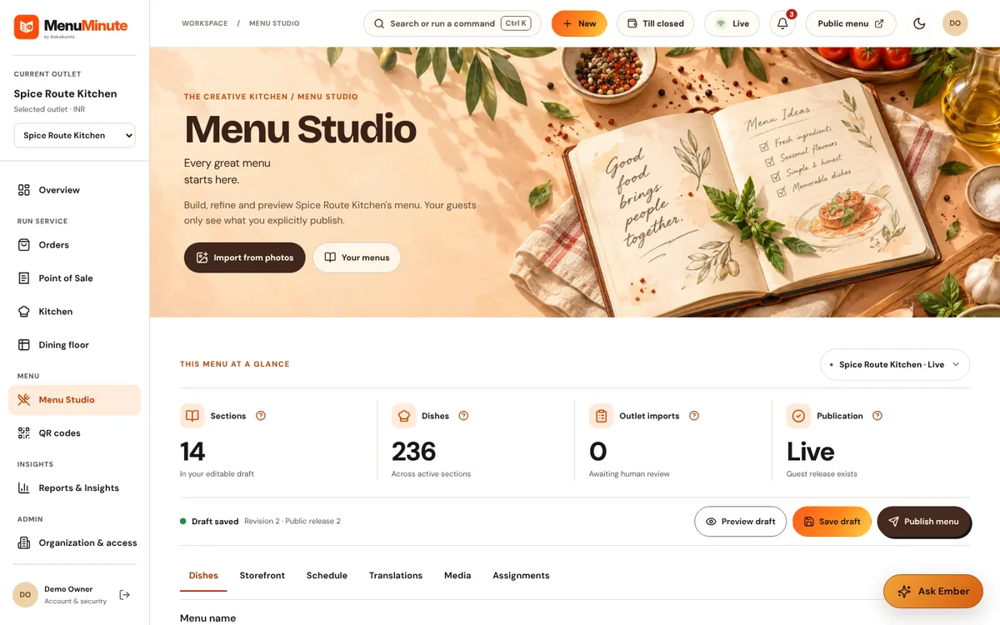</picture> | <picture><source media="(prefers-color-scheme: dark)" srcset="public/docs-media/qr-studio-desktop-dark.webp">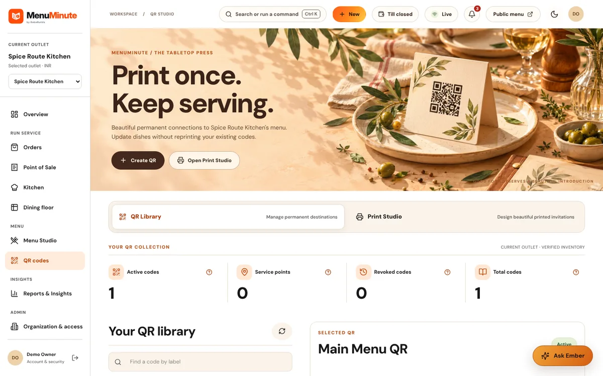</picture> |

|                                                                                          Orders                                                                                          |                                                                                           Kitchen display                                                                                           |
| :--------------------------------------------------------------------------------------------------------------------------------------------------------------------------------------: | :-------------------------------------------------------------------------------------------------------------------------------------------------------------------------------------------------: |
| <picture><source media="(prefers-color-scheme: dark)" srcset="public/docs-media/orders-desktop-dark.webp">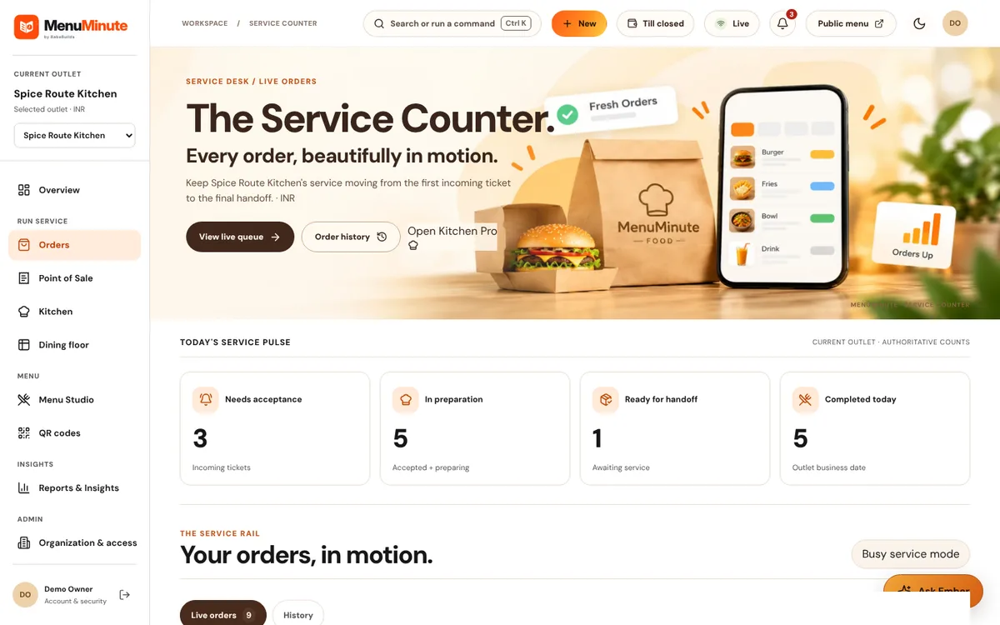</picture> | <picture><source media="(prefers-color-scheme: dark)" srcset="public/docs-media/kitchen-desktop-dark.webp">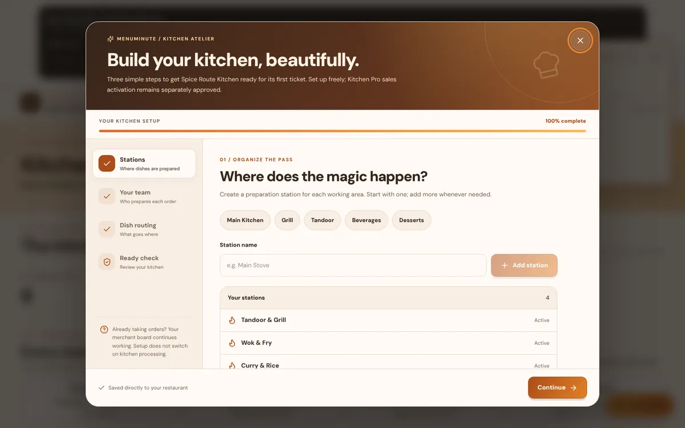</picture> |

|                                                                                         Dining floor                                                                                         |                                                                                           Reports                                                                                           |
| :------------------------------------------------------------------------------------------------------------------------------------------------------------------------------------------: | :-----------------------------------------------------------------------------------------------------------------------------------------------------------------------------------------: |
| <picture><source media="(prefers-color-scheme: dark)" srcset="public/docs-media/floor-desktop-dark.webp">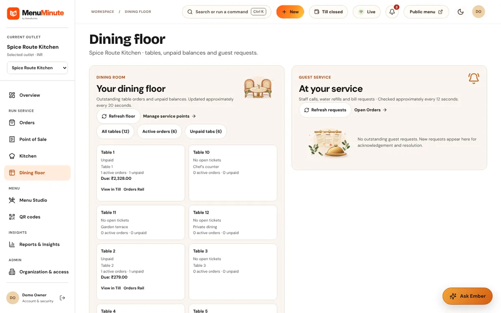</picture> | <picture><source media="(prefers-color-scheme: dark)" srcset="public/docs-media/reports-desktop-dark.webp">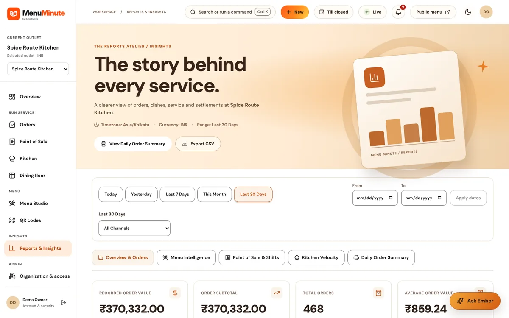</picture> |

**What diners see**

<picture><source media="(prefers-color-scheme: dark)" srcset="public/docs-media/public-menu-desktop-dark.webp">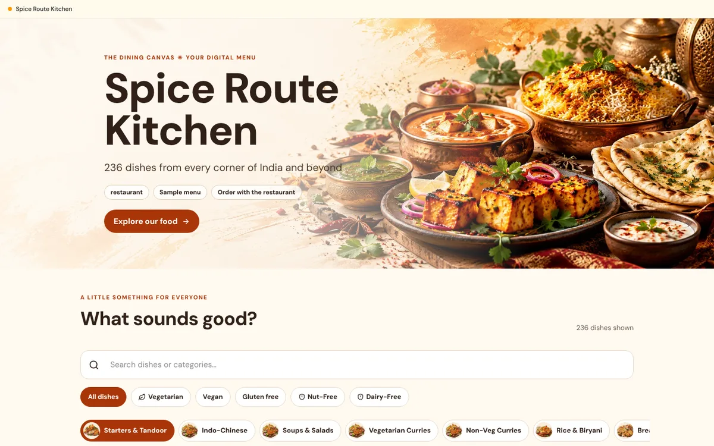</picture>

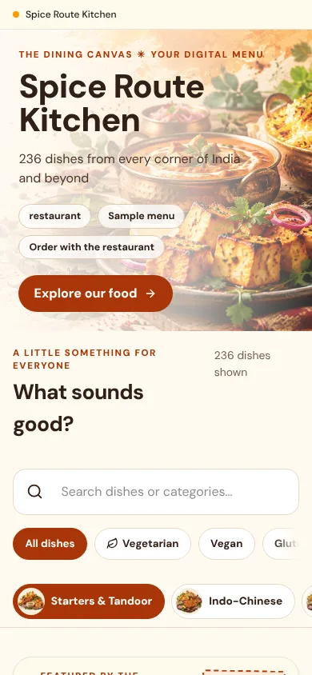 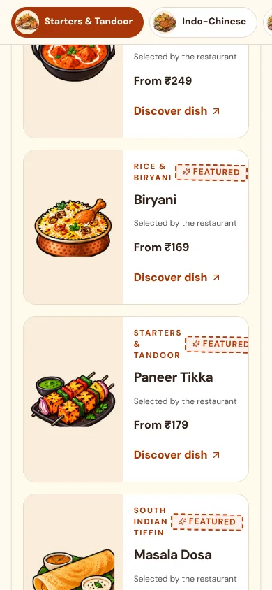 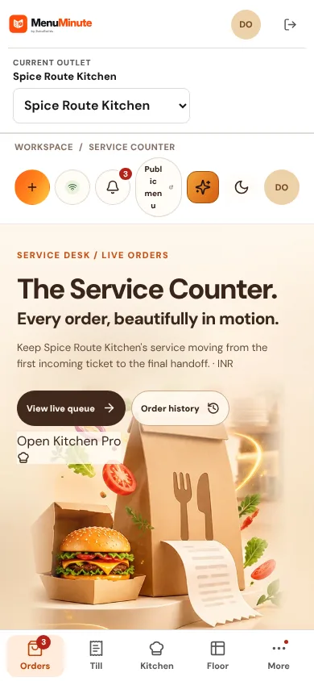

</div>

> Want to click around? The [public demo](docs/demo.md) is a 236-dish sample restaurant with one-click entry that resets every 30 minutes.

---

## 💳 Plans

|                                               |           **Free**           | **Ordering** | **Kitchen Pro** |    **Dedicated**    |
| :-------------------------------------------- | :--------------------------: | :----------: | :-------------: | :-----------------: |
| **Price (India)**                             |        **₹0 forever**        | ₹119 / month |  ₹499 / month   |   ₹30,000 / month   |
| **Price (USD, listed)**                       |              $0              |  $5 / month  |   $20 / month   | $3,000, by contract |
| Outlets                                       |              1               |      1       |    up to 10     |     by contract     |
| Dishes per outlet                             |              20              |     200      |      2,000      |   no platform cap   |
| Permanent QR codes                            |              2               |      25      |       200       |   no platform cap   |
| Guest QR ordering                             | capped intake (100 / month)¹ |      ✅      |       ✅        |         ✅          |
| Table ordering, counter board, order tracking |              —               |      ✅      |       ✅        |         ✅          |
| Kitchen Display System                        |              —               |      —       |       ✅        |         ✅          |

¹ Free-plan order intake is off until an operator enables it. Free menus and QR codes keep working even after paid access ends.

Checkout is disabled by default until the payment provider (Razorpay) is configured. Prices are listed in INR and USD, but only INR is payable today. The numbers above mirror the in-code catalog ([`src/modules/billing/catalog.ts`](src/modules/billing/catalog.ts), [`src/modules/plans/catalog.ts`](src/modules/plans/catalog.ts)); details in [plans and limits](docs/plans-and-limits.md).

---

## 🚀 Quick start

**You'll need:** Node.js 24 LTS (pinned in [`.nvmrc`](.nvmrc)), pnpm 11 (pinned via `packageManager`), and Docker (for the isolated PostgreSQL + Redis test stack).

```bash
git clone https://github.com/baba-dev/menuminute.git
cd menuminute
pnpm install --frozen-lockfile
cp .env.example .env.local
```

Start the dependencies, load your environment and apply the reviewed migrations:

```bash
pnpm infra:test:up
set -a && source .env.local && set +a
NODE_ENV=test pnpm exec tsx scripts/test-bootstrap.ts
pnpm db:migrate
```

Optionally seed a **non-production** sample restaurant, then run the app:

```bash
ALLOW_DEMO_SEED=true DEMO_PASSWORD="choose-a-unique-12+-char-password" pnpm db:seed
pnpm dev
```

Open <http://localhost:3000>.

<details>
<summary><b>🔑 Local demo access</b></summary>

<br>

The seed creates one sample restaurant for local use only. Never run it against production.

|                   |                                                       |
| :---------------- | :---------------------------------------------------- |
| Login             | <http://localhost:3000/login>                         |
| Email             | `demo@menuminute.com`                                 |
| Password          | the `DEMO_PASSWORD` you passed to the seed            |
| Sample restaurant | _Spice Route Kitchen_ (one dish)                      |
| Public menu       | <http://localhost:3000/m/demo-spice-route-kitchen-v1> |

</details>

<details>
<summary><b>🧪 Testing and quality checks</b></summary>

<br>

```bash
pnpm test         # unit + integration (Vitest)
pnpm typecheck    # strict TypeScript
pnpm lint         # ESLint, zero warnings
pnpm test:e2e     # Playwright browser tests
```

Strategy and conventions: [testing strategy](docs/testing-strategy.md) · [development workflow](docs/development.md) · [environment variables](docs/environment.md).

</details>

---

## 🏗️ Architecture

| Layer                | Technology                                           |
| :------------------- | :--------------------------------------------------- |
| **Framework**        | Next.js App Router, React 19                         |
| **Language**         | TypeScript (strict)                                  |
| **Styling**          | Tailwind CSS v4 with custom design tokens            |
| **Database**         | PostgreSQL via `pg`, tenant-scoped transactions      |
| **ORM / migrations** | Drizzle ORM, versioned append-only SQL               |
| **Queues / cache**   | Redis + BullMQ durable jobs                          |
| **Auth**             | Better Auth database sessions                        |
| **Validation**       | Zod v4                                               |
| **QR**               | `qrcode` — SVG and PNG output                        |
| **Images**           | Sharp                                                |
| **Testing**          | Vitest, React Testing Library, Playwright            |
| **Delivery**         | Native ARM64 CI, immutable releases, Nginx + systemd |

```text
src/
├── app/            # App Router pages and route handlers
│   ├── (dashboard)/    # Restaurant management portal
│   ├── (public-menu)/  # Mobile-first diner menu
│   └── api/            # Menu, auth and ordering endpoints
├── components/     # UI and marketing components
├── db/             # Schema, migrations, scoped transactions
├── lib/            # Config, errors, utilities
└── modules/        # Business services: menus, orders, qr, media, billing, ai …
```

Go deeper: [architecture guide](docs/architecture.md) · [database](docs/database.md) · [decisions (ADRs)](docs/decisions.md) · [security](docs/security.md).

<details>
<summary><b>🎨 Design language: Ink &amp; Ember</b></summary>

<br>

Vivid colour on white, gold and orange on charcoal, expressive restaurant typography and selective chef's-note details. Light, dark and system modes apply across marketing, auth, guest, owner and kitchen surfaces.

[Design system](docs/design-system.md) · [Buttons](docs/button-options.md) · [Feedback and motion](docs/feedback-and-motion.md) · [Brand assets](docs/brand-assets.md)

</details>

<details>
<summary><b>🚢 Deployment and release safety</b></summary>

<br>

Merges to `main` flow through native ARM64 CI (quality, TypeScript, isolated PostgreSQL/Redis integration, production build and browser checks), a single aggregate gate on the same SHA, an immutable published release and a gated `production` activation that verifies the public SHA. Releases that change the schema first create and verify an encrypted off-host backup. Runtime media is private local storage; backups go to object storage.

Start with the [production runbook](docs/production-runbook.md), then [deployment](docs/deployment.md), [CI/CD 2.0](docs/deployment-actions.md) and [automatic migrations](docs/automatic-migration-deployment.md). Don't follow first-install examples on an already-live host.

</details>

---

## 📚 Documentation

<table>
<tr>
<td valign="top" width="33%">

**🧭 Start here**

- [Product requirements](docs/product-requirements.md)
- [Product direction](docs/product-direction.md)
- [Roadmap](docs/product-roadmap.md)
- [Architecture](docs/architecture.md)
- [Decisions (ADRs)](docs/decisions.md)
- [Implementation plan](docs/implementation-plan.md)

</td>
<td valign="top" width="33%">

**🛠️ Build**

- [Development workflow](docs/development.md)
- [Environment variables](docs/environment.md)
- [Database and schema](docs/database.md)
- [Dependency plan](docs/dependency-plan.md)
- [Testing strategy](docs/testing-strategy.md)
- [AI development primers](docs/ai-development-primers.md)

</td>
<td valign="top" width="33%">

**🎨 Design**

- [Design system](docs/design-system.md)
- [Design options](docs/design-options.md)
- [Buttons](docs/button-options.md)
- [Feedback and motion](docs/feedback-and-motion.md)
- [Brand assets](docs/brand-assets.md)
- [AI and media policy](docs/ai-and-media.md)

</td>
</tr>
<tr>
<td valign="top">

**🍽️ Product**

- [Menu product contracts](docs/menu-product/contracts.md)
- [Core domain contracts](docs/core-domains/contracts.md)
- [POS](docs/pos/README.md)
- [Kitchen Pro](docs/kitchen-pro-a-d.md)
- [PWA](docs/pwa.md)
- [Public demo](docs/demo.md)

</td>
<td valign="top">

**🔐 Security and trust**

- [Security architecture](docs/security.md)
- [Hardening A–F](docs/security-hardening-a-f.md)
- [Auth 2 security](docs/auth-2-security.md)
- [Privacy](docs/privacy)
- [Legal](docs/legal/README.md)

</td>
<td valign="top">

**🚢 Operations**

- [Production runbook](docs/production-runbook.md)
- [Deployment](docs/deployment.md)
- [CI/CD 2.0](docs/deployment-actions.md)
- [Observability](docs/observability-operations.md)
- [Server inventory](docs/server-inventory.md)
- [Delivery orchestration](docs/orchestration/README.md)

</td>
</tr>
</table>

<details>
<summary><b>🗂️ Delivery phases</b></summary>

<br>

| Phase | Focus                                                             | Reference                                                                                                                                                   |
| :---- | :---------------------------------------------------------------- | :---------------------------------------------------------------------------------------------------------------------------------------------------------- |
| 1     | PostgreSQL, Better Auth, scoped tenancy                           | [Foundation](docs/foundation/phase-1.md)                                                                                                                    |
| 2     | Organizations, outlets, roles, durable jobs, billing entitlements | [Core domains](docs/core-domains/contracts.md) · [Operations](docs/core-domains/operations.md)                                                              |
| 3     | Menu Studio, reviewed media, permanent QR, public menu            | [Contracts](docs/menu-product/contracts.md) · [Operations](docs/menu-product/operations.md)                                                                 |
| 4     | Merchant readiness                                                | [Plan](docs/orchestration/phase-4.md) · [Acceptance](docs/orchestration/phase-4-acceptance.md) · [Ops evidence](docs/orchestration/phase-4-ops-evidence.md) |
| 5     | Kitchen and ordering                                              | [Plan](docs/orchestration/phase-5.md) · [Acceptance](docs/orchestration/phase-5-acceptance.md)                                                              |

</details>

---

## 🤝 Contributing

Contributions are welcome.

1. Read [`AGENTS.md`](AGENTS.md) and the [development workflow](docs/development.md).
2. Open or pick up an [issue](https://github.com/baba-dev/menuminute/issues).
3. Branch from `main`, keep changes focused, and run `pnpm lint`, `pnpm typecheck` and `pnpm test` before opening a PR.
4. Fill in the [pull request template](.github/pull_request_template.md).

Found a security issue? Please report it privately rather than in a public issue — see [security](docs/security.md).

---

## 📄 License

Released under the [MIT License](LICENSE).

<div align="center">

<br>

**Built for restaurants that want to start small and grow without replatforming.**

[🌐 food.bababuilds.com](https://food.bababuilds.com) · [⭐ Star this repo](https://github.com/baba-dev/menuminute) · [🐛 Report a bug](https://github.com/baba-dev/menuminute/issues)

</div>
