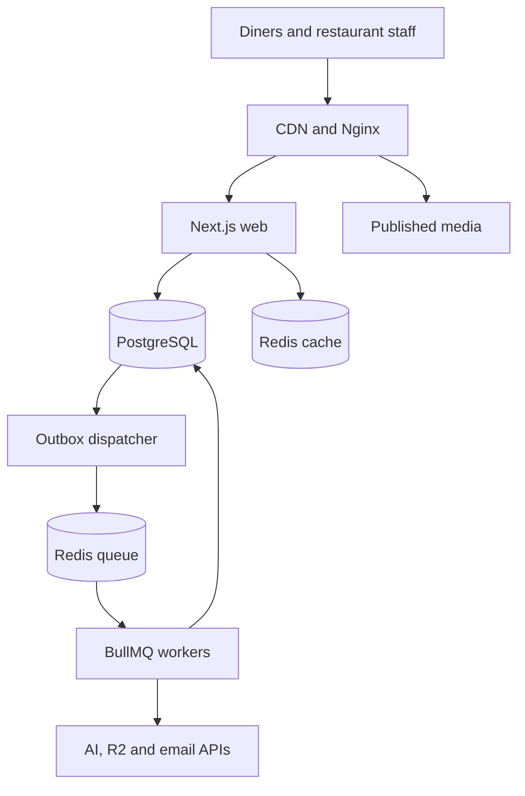

# Approved system architecture

Status: approved target, 2026-10-15. Phase 1 implementation is described in [foundation status](foundation/phase-1.md); Phase 2 adds core management, durable projection delivery and entitlement foundations; ordering remains target work. See [core contracts](core-domains/contracts.md).

## Current scaffold versus target

| Concern    | Current code                                                      | Approved target                                        |
| ---------- | ----------------------------------------------------------------- | ------------------------------------------------------ |
| Database   | PostgreSQL/pg; async foundation/menu services                     | PostgreSQL, Drizzle, pg; asynchronous transactions     |
| Sessions   | Better Auth database sessions                                     | Better Auth, database-backed revocable sessions        |
| Jobs       | PostgreSQL outbox + BullMQ projection worker; no order dispatcher | PostgreSQL outbox/work records + BullMQ workers        |
| Redis      | Bounded queue/cache Redis clients                                 | Separate queue and cache instances                     |
| Orders/KDS | Schema and preview routes                                         | Dine-in/pickup ordering, acceptance and recovery       |
| Deployment | Prepared ARM64 templates; not deployed                            | Ubuntu 24.04 ARM64; shared audited ERP host            |
| AI         | Interfaces returning null                                         | Quota-controlled asynchronous merchant-reviewed drafts |

The approved design is a modular monolith with separately supervised web and worker processes.
Launch supports dine-in and pickup, guest checkout and payment at restaurant/counter. Online payments, delivery,
multi-station routing and autonomous AI actions are outside launch scope.

## Modules and ownership

| Module                    | Owns                                                                   |
| ------------------------- | ---------------------------------------------------------------------- |
| Identity                  | Authentication, sessions, invitation identity                          |
| Organizations/restaurants | Memberships, brands, outlet assignments, service points and policies   |
| Menus                     | Categories, dishes, variants/add-ons, schedules and published versions |
| Orders                    | Authoritative totals, snapshots, idempotency and lifecycle             |
| Kitchen                   | Authorized views, acknowledgement and event recovery                   |
| Billing                   | Subscription entitlements; separate from diner payment state           |
| Media/AI                  | Asset provenance, drafts, quotas and provider adapters                 |
| Infrastructure            | Pools, outbox delivery, jobs, configuration, telemetry                 |

Organization is the tenant boundary; brands and outlets have a scoped many-to-many relationship.
Menus attach to authorized brand/outlet combinations and service points belong to outlets. Map
existing restaurant ownership explicitly during migration; avoid unrelated membership authorities.
See [approved product requirements](product-requirements.md) for roles, outlet-type onboarding,
local currencies, closing-time expiry and the 25-owner / 50-outlet / 1,000-orders/hour launch envelope.
Better Auth organizations may supply identity/membership records, while domain policy enforces
restaurant/outlet access. Record the mapping in the authentication implementation PR.

## Request and data boundaries

Public menu reads resolve a stable token into a published tenant/outlet-scoped projection.
Authenticated writes resolve session membership on the server. Guest order writes use an
explicit scoped public capability and ordering policy, never a freely chosen tenant ID.

Published menu cache keys include restaurant, outlet, locale and menu version. Private responses
are not publicly cached. Menu publishing commits version changes and invalidation intent together;
checkout always revalidates authoritative prices and availability.

Use bounded pg pools per process. Set request, statement and idle-transaction timeouts. Compute
the total pool budget across replicas, workers and maintenance with database headroom.
No provider HTTP call inside an order transaction.

## Live kitchen updates

SSE sends tenant/outlet-scoped signals. Redis Pub/Sub is only an accelerator. Persist events in
PostgreSQL; reconnect fetches missed events and reconciles open orders. Use an ordered per-outlet
cursor allocated under a transaction-scoped serialization mechanism, not a timestamp or an
unqualified database sequence whose allocation order can differ from commit order. Define
retention, cursor expiry and full-resync behavior. Polling provides a fallback.

SSE authenticates subscriptions, rechecks revoked sessions, limits connections, sends heartbeats
and disables proxy buffering. A chime or delivered event is not kitchen acceptance.

## Failure boundaries and growth

PostgreSQL failure rejects new order writes safely. Redis queue failure leaves durable pending
outbox work; PostgreSQL writes can proceed subject to backlog limits and operator policy.
Cache failure permits bounded database fallback. AI/email/media failure never invalidates an order.
See `operations.md` for degraded-mode rules and `order-reliability.md` for recovery.

Start on the shared ARM64 ERP host with independent service memory/concurrency budgets and
separate application accounts, credentials and persistence. See [server inventory](server-inventory.md).
Capacity must be validated alongside ERP peak traffic. This is not HA.
Scale from measured dinner-time peaks: move the database/workers off-host, add web replicas,
coordinate Next.js cache invalidation and deployment identity, then introduce database failover.
Partition/archive history only after query plans and retention measurements justify it.
Millions of stored orders is not a tested throughput guarantee.

## Reading order

1. `decisions.md` and `dependency-plan.md`
2. `domain-invariants.md` and `order-reliability.md`
3. `security.md`, `database.md` and `environment.md`
4. `operations.md`, `deployment.md` and `testing-strategy.md`
5. `ai-development-primers.md`, `design-system.md` and `implementation-plan.md`
