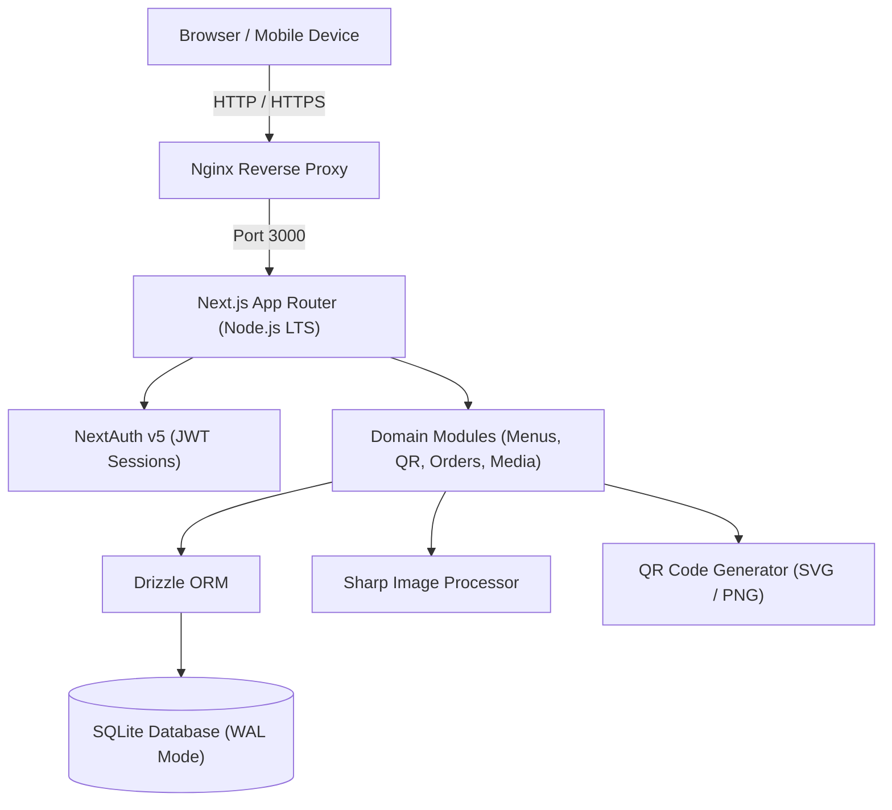

# MenuMinute — Architecture Documentation

## 1. High-Level System Architecture

MenuMinute is designed as a **modular monolith** running Next.js App Router with TypeScript on Node.js. It adheres strictly to modern web architecture principles:

- **Server-Side Rendering (SSR) & Server Components by Default**: All data fetching, authorization assertions, and query executions occur exclusively on the server.
- **Client Components on Demand**: Interactivity (modals, client forms, toasts) is isolated to leaf client components (e.g. `MenuManager`).
- **Single-Process Lightweight Infrastructure**: Powered by SQLite via `better-sqlite3` and `drizzle-orm`, eliminating external database connection latency, connection pooling overhead, and complex infrastructure requirements.
- **Tenant Isolation**: Strict logical multi-tenancy where every query scopes data to the authenticated restaurant tenant (`restaurantId`).



---

## 2. Directory Structure

```text
src/
  app/
    (marketing)/         # Marketing landing page, pricing, demo
    (auth)/              # Login, register, session callbacks
    (dashboard)/         # Restaurant administrative portal (Overview, Menu, QR, Orders, Settings)
    (public-menu)/       # Customer-facing public menu view (/m/[publicMenuId])
    api/                 # REST endpoints for auth, menu CRUD, and media
  components/
    ui/                  # Design system primitives & tokens
    shared/              # Reusable layout and navigation components
  modules/
    auth/                # User authorization & session helpers
    restaurants/         # Tenant retrieval and tenant assertions
    menus/               # Category & item services with validation
    qr/                  # High-density SVG & PNG QR code generator
    orders/              # Order lifecycle & state machines (Phase C)
    kitchen/             # Kitchen Display System workflows (Phase D)
    billing/             # Subscription tiers & entitlements
    ai/                  # Provider-agnostic AI interfaces (Phase B)
    media/               # Storage adapters & image processing pipeline
  db/
    schema/              # Type-safe Drizzle schema definitions
    migrations/          # Versioned SQL migrations generated by drizzle-kit
    index.ts             # Singleton connection & production SQLite pragmas
  lib/
    config/              # Validated environment configuration (Zod)
    errors/              # Typed AppError hierarchy and safe serialisation
    utils/               # Formatting (currency, slugs, classnames)
  styles/
    globals.css          # Design tokens & Tailwind v4 theme definitions
```

---

## 3. Image Resolution Strategy (Phase B Pipeline)

When a dish is displayed on the customer menu, MenuMinute resolves image assets using a strict fallback hierarchy:

1. **Restaurant-Uploaded Photograph**: Original high-resolution photo processed via Sharp (capped at 2000px, JPEG quality 85).
2. **Approved Reusable Dish-Image Library**: Curated internal library of common dish photography.
3. **Licensed Pexels Stock-Photo Suggestion**: Free-tier licensed photos via Pexels API with mandatory photographer attribution.
4. **AI-Generated Illustrative Image**: Controlled image synthesis via NVIDIA NIM / Cloudflare Workers AI.
5. **Local Category SVG Fallback**: Lightweight custom SVG illustrations (beverages, desserts, breads, starters, etc.).
