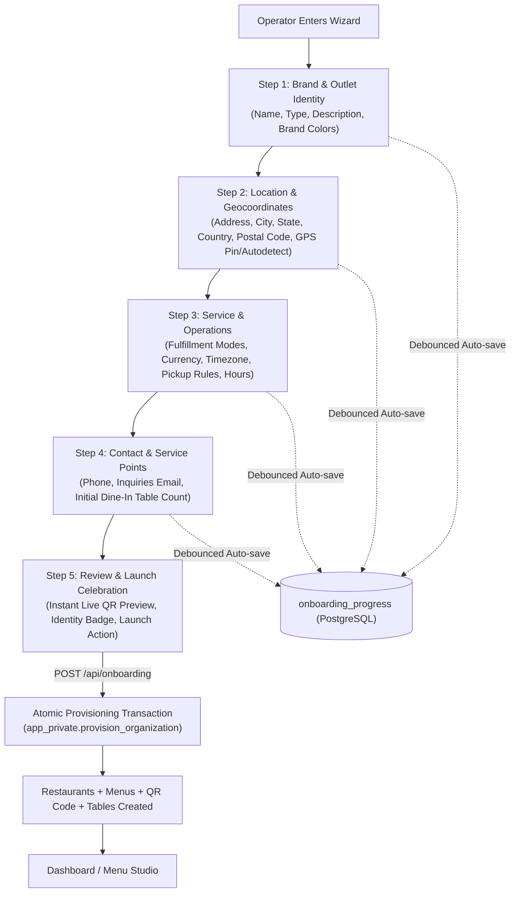

# Implementation Plan: Super Onboarding Wizard & Shop Geocoordinates

## Goal Description

Build an end-to-end **Super Onboarding Wizard** for MenuMinute that guides users through creating and personalizing their organization and shop/outlet. This includes:

1. Auditing all required and optional settings for a **User** and their **Shop / Outlet** across the database.
2. Extending the database schema and PostgreSQL stored procedures to capture and persist **physical addresses and precise geocoordinates (latitude/longitude)**.
3. Designing an elegant, responsive **Super Onboarding Wizard modal / popup and dedicated page** featuring progressive disclosure, auto-save idempotency, GPS coordinate detection, and celebration animations.
4. Providing a structured **SVG and mediawork asset brief** so custom brand vectors and illustrations can be generated with ChatGPT and dropped into the application.

---

## Database Audit: Required & Optional Settings

An inspection of the schema (`src/db/schema/*`), migrations, and security procedures (`app_private.provision_organization` and `app_private.update_outlet_profile`) reveals three layers of state required for an operator to run:

### 1. User Identity (`users`, `two_factor`, `accounts`)

| Field                              | Type             | Required                                      | Description / Purpose                                                     |
| :--------------------------------- | :--------------- | :-------------------------------------------- | :------------------------------------------------------------------------ |
| `name`                             | text             | **Yes**                                       | Operator full name displayed in workspace header and audit logs.          |
| `email`                            | text (unique)    | **Yes**                                       | Primary login and verified identity.                                      |
| `emailVerified`                    | boolean          | **Yes**                                       | Account verification gate (unverified accounts cannot provision outlets). |
| `twoFactorEnabled`                 | boolean          | Optional (Mandatory for admins by org policy) | MFA authentication status.                                                |
| `image`                            | text             | Optional                                      | Avatar / profile photo URL.                                               |
| `termsVersion` / `termsAcceptedAt` | text / timestamp | **Yes**                                       | Legal terms and conditions agreement.                                     |

### 2. Organization / Tenant Boundary (`organizations`, `organization_members`)

| Field         | Type               | Required        | Description / Purpose                                                  |
| :------------ | :----------------- | :-------------- | :--------------------------------------------------------------------- |
| `name`        | text (2–100 chars) | **Yes**         | Business / legal company name (e.g. "Bella Napoli Hospitality LLC").   |
| `mfaRequired` | boolean            | Default `true`  | Security posture for staff.                                            |
| `role`        | text               | Default `owner` | First creator receives `owner` with complete operational entitlements. |

### 3. Shop / Outlet Settings (`restaurants`, `menus`, `qr_codes`)

| Field                  | Type                | Current DB Support                     | Wizard Role / Enhancement                                                                                    |
| :--------------------- | :------------------ | :------------------------------------- | :----------------------------------------------------------------------------------------------------------- |
| `name`                 | text (2–100 chars)  | Exists                                 | **Required**: Outlet public name (e.g., "Bella Napoli - Downtown").                                          |
| `outletType`           | enum                | Exists                                 | **Required**: `restaurant`, `cafe`, `takeout`, `cloud_kitchen`, `hotel`, `mixed`. Sets default fulfillments. |
| `description`          | text (max 500)      | Exists                                 | Guest-facing bio, specialties, or story.                                                                     |
| `country`              | text (2-letter ISO) | Exists                                 | **Required**: e.g., `IN`, `OM`, `US`, `AE`, `GB`. Drives default currency & tax.                             |
| `currency`             | text (ISO 4217)     | Exists                                 | **Required**: Transaction currency (`INR`, `USD`, `EUR`, `OMR`, `AED`, etc.).                                |
| `timezone`             | text (IANA)         | Exists                                 | **Required**: IANA timezone (e.g., `Asia/Kolkata`, `Asia/Dubai`) for service session expiries.               |
| `fulfillmentModes`     | text[]              | Exists                                 | **Required**: `dine_in`, `pickup` (one or both required).                                                    |
| `addressLine1`         | text (max 180)      | Exists in schema, missing in provision | Street address and building name.                                                                            |
| `addressLine2`         | text (max 180)      | Exists in schema, missing in provision | Suite, floor, or landmark.                                                                                   |
| `city`                 | text (max 100)      | Exists in schema                       | City / metropolitan area.                                                                                    |
| `state`                | text (max 100)      | Exists in schema, missing in provision | State, region, or province.                                                                                  |
| `postalCode`           | text (max 24)       | Exists in schema, missing in provision | ZIP or postal code.                                                                                          |
| **`latitude`**         | `numeric(10, 7)`    | **MISSING — TO BE ADDED**              | GPS latitude coordinate (-90.0 to +90.0, 7 decimal places).                                                  |
| **`longitude`**        | `numeric(10, 7)`    | **MISSING — TO BE ADDED**              | GPS longitude coordinate (-180.0 to +180.0, 7 decimal places).                                               |
| `phone`                | text (max 40)       | Exists in schema, missing in provision | Guest phone / WhatsApp order contact.                                                                        |
| `email`                | text (max 254)      | Exists in schema, missing in provision | Public outlet inquiries email.                                                                               |
| `website`              | text (max 512)      | Exists in schema, missing in provision | Public website / social link (Instagram, Linktree).                                                          |
| `primaryColor`         | text (hex #RRGGBB)  | Exists in schema (default `#f97316`)   | Brand accent color for QR menus and badges.                                                                  |
| `secondaryColor`       | text (hex #RRGGBB)  | Exists in schema (default `#1c1917`)   | Brand surface / contrast color.                                                                              |
| `pickupLeadMinutes`    | integer (0–240)     | Exists (default 15)                    | Default prep time buffer for pickup orders.                                                                  |
| `pickupSlotMinutes`    | integer (5–120)     | Exists (default 15)                    | Scheduling increment.                                                                                        |
| `pickupAdvanceDays`    | integer (1–30)      | Exists (default 7)                     | Maximum advance ordering horizon.                                                                            |
| `menuSchedule`         | jsonb               | Exists                                 | Weekly opening / closing operating hours.                                                                    |
| Initial Service Tables | integer count       | Exists via `restaurant_tables`         | Provision initial Dine-In tables (e.g. Tables 1–10).                                                         |

---

## User Review Required

> [!IMPORTANT]
> **Database & Function Migration Contract**:
> MenuMinute uses hardened PostgreSQL stored procedures with security definer permissions (`app_private.provision_organization` and `app_private.update_outlet_profile`).
>
> 1. `restaurants` must be altered to add `latitude numeric(10, 7)` and `longitude numeric(10, 7)`.
> 2. `app_private.provision_organization` must be updated so that address, geocoordinates, contact, and branding fields are inserted atomically during outlet creation instead of leaving them empty.
> 3. `app_private.update_outlet_profile` must accept and persist `latitude` and `longitude`.
> 4. All migrations must be append-only (`0028_outlet_geocoordinates_and_onboarding.sql`) and registered in `meta/_journal.json`.

> [!NOTE]
> **Onboarding Wizard Accessibility**:
> The wizard will be available in two presentation modes:
>
> - **Full Page (`/onboarding`)**: Triggered immediately after registration/email verification when an owner has no outlets.
> - **Modal Popup / Drawer (`<OnboardingWizardModal />`)**: Can be invoked inside the dashboard (e.g., from workspace switcher "Add new outlet" or "Complete setup" banner) without navigating away.

---

## Super Onboarding Wizard Architecture

### Wizard Step Breakdown

#### Step 1: Brand & Outlet Identity

- **Outlet Name**: Live character counter (2–100 chars).
- **Outlet Type Cards**: Interactive selectable tiles with custom icons:
  - Restaurant / Diner
  - Cafe / Quick Service
  - Takeout
  - Cloud Kitchen
  - Hotel / Food Service
  - Other / Mixed
- **Short Bio / Story**: Multi-line description (up to 500 characters).
- **Brand Palette Picker**: Interactive preset palettes (Amber Ember, Emerald Green, Indigo Night, Crimson Rose, Obsidian) + Custom HEX picker with real-time preview badge.

#### Step 2: Location & Geocoordinates (Core Feature)

- **Street Address**: Line 1 (Street & Number) and Line 2 (Unit / Floor / Landmark).
- **City, State / Province, Postal Code**.
- **Country Selector**: 200+ ISO country selector that automatically suggests matching currency and timezone.
- **Geocoordinates Card**:
  - `Latitude` (e.g., `19.0760000`) and `Longitude` (e.g., `72.8777000`).
  - **"Locate Me" Button**: Integrates HTML5 Geolocation API (`navigator.geolocation.getCurrentPosition`) with permission handling, accuracy readout, and fallback.
  - **Coordinate Verification Pill**: Visual indicator confirming coordinates are valid coordinates within range (-90 to +90 lat, -180 to +180 lng).

#### Step 3: Service, Hours & Operations

- **Fulfillment Modes**: Dine-in and/or Pickup switches (auto-configured defaults based on outlet type selected in Step 1).
- **Currency & Timezone**: Verified currency selection from supported catalog with minor-unit exponent awareness.
- **Pickup Rules** (if pickup selected): Lead time (e.g. 15 mins), slot window, advance ordering days.
- **Weekly Schedule**: Collapsible service window editor.

#### Step 4: Contact & Dine-In Tables

- **Public Phone & WhatsApp**: Direct contact number.
- **Public Support Email & Website**: Social link or homepage.
- **Initial Table Provisioning**: Table count slider/input (e.g. 5, 10, 20 tables) to auto-generate `restaurant_tables` ("Table 1", "Table 2"...) so Dine-In QR ordering works out of the box!

#### Step 5: Review & Launch Celebration

- **Interactive Holographic Card**: Displays outlet name, type, address, GPS badge, colors, and operating hours.
- **Live Menu QR Code Preview**: Dynamically rendered QR code using the selected brand colors.
- **Launch Button**: Confirms setup, executes atomic provisioning, and triggers celebratory particle/confetti effect before transitioning to `/dashboard/menu`.

---

## Mediawork, Icons & SVG Generation Roadmap (ChatGPT Prompts)

The user will generate the SVGs using ChatGPT. Below is the exact asset catalog with specifications, design rules, and prompt blueprints:

### Asset Design Rules

1. **Format**: Valid SVG (`xmlns="http://www.w3.org/2000/svg"`, `viewBox="0 0 24 24"` for icons, `viewBox="0 0 400 240"` for step illustrations).
2. **Color Palette**: Use CSS `currentColor` or harmonize with MenuMinute's Amber/Stone tokens (`#f97316` primary orange, `#1c1917` obsidian background, `#292524` stone borders, `#fef3c7` glow).
3. **Responsive & Vector**: Pure vector shapes (paths, strokes), no embedded bitmaps or raster fonts.

### 1. Step Hero Illustrations (`viewBox="0 0 400 240"`)

| Step   | Target Filename              | Concept / ChatGPT Prompt                                                                                                                                                                                                                                                                             |
| :----- | :--------------------------- | :--------------------------------------------------------------------------------------------------------------------------------------------------------------------------------------------------------------------------------------------------------------------------------------------------- |
| Step 1 | `wizard-hero-identity.svg`   | _"Create a sleek, modern, minimalist SVG illustration (400x240, dark mode stone-900 background #1c1917) showing a glowing restaurant storefront with warm amber lighting (#f97316), an elegant hanging sign, clean architectural lines, and geometric accents."_                                     |
| Step 2 | `wizard-hero-location.svg`   | _"Create a futuristic, minimalist SVG illustration (400x240, stone-900 background #1c1917) showing an isometric map grid with glowing radar contour lines, an amber GPS pin dropping onto the map with subtle pulse ripples, and subtle latitude/longitude coordinates floating in the background."_ |
| Step 3 | `wizard-hero-operations.svg` | _"Create a stylish, minimalist SVG illustration (400x240, stone-900 background #1c1917) depicting a fusion of an elegant clock face, chef cloche, and coffee steam rings, rendered in warm amber (#f97316) and soft champagne lines."_                                                               |
| Step 4 | `wizard-hero-contact.svg`    | _"Create a minimalist vector illustration (400x240, stone-900 background #1c1917) of a warm bistro dining table with an illuminated QR menu stand, two modern chairs, and subtle digital phone waves in the air."_                                                                                   |
| Step 5 | `wizard-hero-launch.svg`     | _"Create a celebratory SVG illustration (400x240, stone-900 background #1c1917) showing a golden cloche lifting to reveal a sparkling glowing QR code, surrounded by subtle amber confetti, stars, and celebratory light bursts."_                                                                   |

### 2. Outlet Type Icons (`viewBox="0 0 48 48"`)

- `type-restaurant.svg`: Sophisticated fork, knife, and dining cloche.
- `type-cafe.svg`: Artisan ceramic coffee cup with delicate rising steam.
- `type-takeout.svg`: Modern kraft paper takeout bag with handles and clock emblem.
- `type-cloud-kitchen.svg`: Ghost kitchen frying pan over glowing precision flames.
- `type-hotel.svg`: Classic hotel service bell with elegant arches.
- `type-mixed.svg`: Geometric 4-quadrant dynamic hospitality badge.

### 3. Interactive Functional Icons (`viewBox="0 0 24 24"`)

- `icon-gps-locate.svg`: Reticle target with radar wave animation pulse.
- `icon-color-swatch.svg`: Dual-tone teardrop paint palette.
- `icon-table-grid.svg`: 2x2 modular dining layout grid.
- `icon-spark-check.svg`: Checkmark with celebratory diamond sparks.

---

## Proposed Code Changes

### Database & Migration Layer

#### [NEW] `src/db/migrations/0028_outlet_geocoordinates_and_onboarding.sql`

- Add `latitude numeric(10, 7)` and `longitude numeric(10, 7)` columns to `restaurants`.
- Update `app_private.provision_organization` to insert address fields (`address_line1`, `address_line2`, `state`, `postal_code`), geocoordinates (`latitude`, `longitude`), contact (`phone`, `email`, `website`), branding (`primary_color`, `secondary_color`), and table count into `restaurants` and `restaurant_tables`.
- Update `app_private.update_outlet_profile` to validate and update `latitude` and `longitude`.

#### [MODIFY] `src/db/migrations/meta/_journal.json`

- Register `0028_outlet_geocoordinates_and_onboarding`.

#### [MODIFY] `src/db/schema/restaurants.ts`

- Add `latitude: decimal("latitude", { precision: 10, scale: 7 })` and `longitude: decimal("longitude", { precision: 10, scale: 7 })` to `restaurants` table definition and export types.

---

### Domain & Services Layer

#### [MODIFY] `src/modules/restaurants/service.ts`

- Update `createRestaurantSchema` to include address fields (`addressLine1`, `addressLine2`, `state`, `postalCode`), `latitude`, `longitude`, `phone`, `email`, `website`, `primaryColor`, `secondaryColor`, and `tableCount`.
- Pass these fields through `app_private.provision_organization`.

#### [MODIFY] `src/modules/restaurants/profile.ts`

- Add `latitude` and `longitude` to `outletProfileFieldsSchema` and `editableOutletProfile`.

#### [MODIFY] `src/modules/onboarding/service.ts`

- Expand `onboardingDraftSchema` so partial progress for all new address and geocoordinates fields is safely parsed and saved in `onboarding_progress.draft`.

---

### UI & Component Layer

#### [NEW] `src/components/onboarding/onboarding-wizard-modal.tsx`

- Dialog / Popup component wrapped in Radix UI Dialog / Portal with backdrop blur.
- Can be mounted on `/dashboard` or triggered on any page.

#### [NEW] `src/components/onboarding/wizard-steps/step-identity.tsx`

- Outlet Name, Outlet Type selector cards, Description, Brand color presets & picker.

#### [NEW] `src/components/onboarding/wizard-steps/step-location.tsx`

- Street address lines, City, State, Country, Postal code.
- Interactive HTML5 Geolocation "Use my GPS coordinates" with coordinate validation & map pin visual.

#### [NEW] `src/components/onboarding/wizard-steps/step-operations.tsx`

- Fulfillment modes, Currencies, Timezone, Pickup scheduling parameters, Weekly opening hours.

#### [NEW] `src/components/onboarding/wizard-steps/step-contact-tables.tsx`

- Public phone, inquiries email, website, and initial Dine-In table generation slider.

#### [NEW] `src/components/onboarding/wizard-steps/step-launch.tsx`

- Summary review card, live QR code preview with custom brand colors, launch action with celebration particles.

#### [NEW] `src/components/onboarding/onboarding-wizard.css`

- Obsidian & warm amber styling, step slide transitions, responsive mobile layout, accessible focus rings.

#### [MODIFY] `src/app/onboarding/page.tsx` & `src/app/onboarding/setup-form.tsx`

- Integrate the super onboarding wizard components into the standalone `/onboarding` route, maintaining full backward compatibility with session continuity and idempotent retry.

#### [MODIFY] `src/app/(dashboard)/dashboard/settings/outlet-atelier.tsx`

- Add Latitude and Longitude fields to the Contact & Location section so operators can view and edit their geocoordinates after onboarding.

---

## Verification Plan

### Automated Tests

1. **Unit & Domain Tests**:
   - `tests/onboarding-lifecycle.test.ts`: Verify saving and provisioning with addresses, latitude, and longitude.
   - `tests/outlet-profile.test.ts`: Verify updating geocoordinates via `update_outlet_profile`.
   - `pnpm test tests/onboarding-lifecycle.test.ts`
   - `pnpm test tests/production-fh-contracts.test.ts`
2. **Typecheck & Linting**:
   - `pnpm check` or `pnpm tsc --noEmit`
   - `pnpm lint`

### Manual Verification

1. **Standalone Onboarding Flow**:
   - Register a new account -> land on `/onboarding`.
   - Verify Step 1–5 flow, test "Use my GPS coordinates" button, inspect live QR code color adaptation.
   - Complete setup -> verify redirected to `/dashboard/menu` with outlet, address, geocoordinates, and initial tables populated.
2. **Reload & Idempotency Check**:
   - Fill in Step 1 and Step 2 with address and coordinates.
   - Refresh the page -> verify form rehydrates with saved progress from `onboarding_progress`.
3. **Settings / Outlet Atelier Check**:
   - Visit `/dashboard/settings` -> verify address, latitude, and longitude appear in the Contact & Location section and can be edited.

---

## Production hardening reconciliation (2026-10-27)

- The onboarding migration is renumbered to `0029` after existing Kitchen Pro activation `0028`.
- A first-owner onboarding draft is **not** the same workflow as adding an outlet to an existing organization; the reusable modal explicitly describes first-outlet completion. Future additional-outlet creation must use its own authorized organization workflow.
- Pickup-only and cloud-kitchen outlets never auto-create dining tables.
- Provisioning remains private until the menu is explicitly published. Paid online ordering/Kitchen Pro capabilities are not enabled by onboarding.
- The final review intentionally shows a decorative QR placeholder, not a nonfunctional scannable code. Real QR links are generated using the server-owned public token and become useful when the menu is published.
- Light/dark WebP stage artwork is optional. React renders safe inline SVG fallbacks while the commissioned media is being prepared.
- Missing production QA: deployed HTTP smoke tests, browser screenshots, independent security approval, and final CI checks must be verified before merging.
