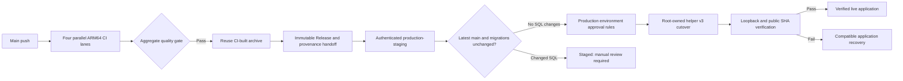

# MenuMinute: GitHub Actions -> shared ARM64 VPS

This is the **subsequent-release** deployment path; the 2026-10-16 first install was performed
manually, with live deployment SHA and filesystem contract recorded in
[production runbook](production-runbook.md). After successful `main` CI and publication of the
immutable ARM64 release, the workflow verifies that the run is still the latest `main`, stages it,
and automatically activates it only when the running and candidate migration trees are identical.
It never builds on the ERP VPS. PRs cannot stage/deploy. It never runs SQL migrations; a
migration-changing release remains staged for the manual, root-marker-gated activation path. Staging uses a dedicated `production-staging` environment. Only an eligible cutover runs in the GitHub `production` environment; its configured review gate, exact-SHA, ERP and MenuMinute readiness checks still apply.

The deployment script and workflow live at
`infra/deploy/menuminute-release` and `.github/workflows/deploy-vps.yml`.
Review both before granting the deploy SSH key.

## 1. Verify the shared host before provisioning

From a trusted administrator session on the **selected Oracle ARM64 host**:

```bash
uname -m                         # aarch64
/usr/bin/node -p 'process.version + " " + process.arch' # ERP baseline, do not replace
/opt/menuminute/node24/bin/node -p 'process.version + " " + process.arch' # v24 arm64 once installed
df -h /                           # maintain >=4GiB free for staging, much more for runtime
ss -ltnp | grep -E ':(3000|3100|6381|6382)\b' || true
systemctl is-active nginx
curl -sS -o /dev/null -w '%{http_code}\n' http://127.0.0.1:3000/
```

Do not disturb ERP's port 3000, PM2, DB, Nginx server block, certificates or
CrowdSec/firewall rules. MenuMinute uses **127.0.0.1:3100**, consistent with the
committed systemd and Nginx templates; the earlier 3001 in server inventory is
superseded. Confirm actual domain, Nginx routing and TLS independently. No
firewall change is required to make port 3100 public; it must stay on loopback.

Before an activation, verify the already-provisioned PostgreSQL (separate owner/app/worker roles),
two loopback Redis instances (queue 6381, cache 6382), off-host backups and
a successful restore rehearsal. `infra/compose.test.yml` is **not** production
infrastructure. Never use the CI demo secrets in production.

## 2. One-time VPS account/directories

Run these as an administrator **only after reviewing the paths**. Do not
replace an existing production account/unit without comparing it first.

```bash
sudo id menuminute
sudo id menuminute-worker
sudo getent group menuminute-media
# The three runtime identities above must be provisioned separately.
# If the deploy account already exists, preserve it; do not recreate/reset its SSH keys.
id menuminute-deploy || sudo useradd --system --user-group --create-home \
  --home-dir /var/lib/menuminute/deploy --shell /bin/bash menuminute-deploy
sudo install -d -o root -g root -m 0755 /var/www/menuminute /var/www/menuminute/releases
sudo install -d -o root -g root -m 0755 /var/lib/menuminute
sudo install -d -o menuminute-deploy -g menuminute-deploy -m 0700 /var/lib/menuminute/incoming
sudo install -d -o menuminute -g menuminute -m 0770 \
  /var/lib/menuminute/cache /var/lib/menuminute/tmp
sudo install -d -o menuminute-worker -g menuminute-worker -m 0770 \
  /var/lib/menuminute/worker-tmp
sudo install -d -o root -g root -m 0700 \
  /etc/menuminute /etc/menuminute/approved-releases
```

For `/var/lib/menuminute/media`, configure the shared `menuminute-media`
group and permissions according to the real storage provider; do not open
world-writable access. Do not replace the shared `/usr/bin/node`: the
existing ERP is on Node 20. MenuMinute uses a **private, root-owned Node 24**
at `/opt/menuminute/node24/bin/node` for staging and its web/worker
systemd units. This avoids a global Node/package-manager update.

Install a pinned official Linux ARM64 runtime alongside the existing one;
verify the downloaded archive against the publisher's SHA-256 manifest.
This example uses Node v24.22.0 (2026-10-14); review the version and
trusted Node.js publisher origin before executing:

```bash
set -euo pipefail
ver=v24.22.0
archive="node-${ver}-linux-arm64.tar.xz"
tmp="$(mktemp -d)"
trap 'rm -rf -- "$tmp"' EXIT
curl -fsSLo "$tmp/$archive" "https://nodejs.org/dist/$ver/$archive"
curl -fsSLo "$tmp/SHASUMS256.txt" "https://nodejs.org/dist/$ver/SHASUMS256.txt"
(cd "$tmp"; grep -F "  $archive" SHASUMS256.txt | sha256sum -c -)
test ! -e /opt/menuminute/node24 && test ! -L /opt/menuminute/node24
sudo install -d -o root -g root -m 0755 /opt/menuminute
sudo tar -xJf "$tmp/$archive" -C /opt/menuminute --no-same-owner
sudo mv "/opt/menuminute/node-$ver-linux-arm64" "/opt/menuminute/node-$ver"
sudo ln -s "/opt/menuminute/node-$ver" /opt/menuminute/node24
/opt/menuminute/node24/bin/node -p 'process.version + " " + process.arch'
/usr/bin/node -v  # Unchanged shared ERP runtime
```

For an existing live MenuMinute instance, **do not install/overwrite the
systemd units while preparing the SSH deploy account**. Inspect
`systemctl cat menuminute-web.service menuminute-worker.service` and the
existing rollback/startup arrangements first. Before activation, review and
install the updated web/worker unit templates (or targeted ExecStart
overrides) with this private Node 24 path, perform `systemctl daemon-reload`
and test compatibility with the old release. Activation refuses a unit that
still invokes a different Node binary. Changes to units, the dedicated
TLS-enabled Nginx site and production env files are separate operator
decisions, never GitHub Actions writes.

Preserve existing root-owned `/etc/menuminute/web.env` and
`/etc/menuminute/worker.env` in systemd `EnvironmentFile` format with mode 0600. The first provisioning placed the migration-owner URL in
`/etc/menuminute/migration-db.env`; this _optional_ deploy workflow's invocation expects
`/etc/menuminute/migration.env`. The operator must deliberately provision/validate the latter
as a root-only 0600 **shell-compatible assignment with only MIGRATION_DATABASE_URL** if choosing
that path; do not assume it is installed or substitute a runtime-role URL.
The runtime roles must have neither migration-owner credentials nor
SUPERUSER/BYPASSRLS privileges.

Install the reviewed release script from a **pinned, reviewed main SHA**, e.g.:

```bash
# Replace REVIEWED_SHA with the 40-character reviewed commit from merged PR.
curl -fL "https://raw.githubusercontent.com/baba-dev/menuminute/REVIEWED_SHA/infra/deploy/menuminute-release" \
  -o /tmp/menuminute-release
bash -n /tmp/menuminute-release
sudo install -o root -g root -m 0750 /tmp/menuminute-release /usr/local/sbin/menuminute-release
sudo visudo -f /etc/sudoers.d/menuminute-deploy
```

Insert this _single allowlisted command_ in that sudoers file, then
`sudo chmod 0440 /etc/sudoers.d/menuminute-deploy` and
`sudo visudo -cf /etc/sudoers.d/menuminute-deploy`:

```sudoers
menuminute-deploy ALL=(root) NOPASSWD: /usr/local/sbin/menuminute-release *
```

The audited v3 script allows only `stage`, `eligibility`, `activate`,
`autoactivate`, `verify` and schema-compatible `recover`, validates full commit/checksum hex, confines its
paths to MenuMinute, and uses `flock`. Install this helper from the merged PR
commit before automatic activation is enabled; the source change alone does
not replace the root-owned VPS copy.
Never give the deploy account blanket sudo, root SSH, password login, git push,
PM2, service-manager or Nginx permissions. The account may write only its
incoming artifact and its own SSH home. Do not run a self-hosted Actions runner
on the shared ERP host.

The repository's release assets are public. GitHub Actions first verifies
the immutable release tag, full SHA and the published archive checksum on its
runner; it then asks the dedicated SSH account to **pull that exact asset over
GitHub HTTPS directly to the VPS** using curl. SSH transports only the small
command, not the large archive. The URL is derived from the trusted repository
name and verified release SHA. No GitHub token is stored on the VPS.
The HTTPS transfer uses `--continue-at -` to resume an interrupted incoming
archive, skips HTTP downloading when the archive already has its expected size
(to avoid a Range-at-EOF HTTP 416 on repeat activation), has a slow-transfer
timeout, only follows HTTPS redirects and checks its expected byte length. The root-owned staging helper independently copies
and SHA-256-verifies the full archive before extraction. An interrupted partial
file must not be removed or overwritten by a competing transfer; if HTTP
Range resumption fails, check that no writer remains before examining it.
The previous SSH/rsync push transport is superseded; `rsync` is not needed
for this workflow.

## 3. One dedicated SSH key and host pin

Generate an **independent** key on a trusted administrator workstation (not
in this chat or the repository):

```bash
ssh-keygen -t ed25519 -a 100 -f ./menuminute_actions_deploy -C menuminute-actions
```

For unattended Actions, store the private key as the GitHub environment secret
below, restrict who can approve production, and rotate the key if exposed.
Append the public key to
`/var/lib/menuminute/deploy/.ssh/authorized_keys` owned by
`menuminute-deploy`, with `restrict` prefixed to the public-key line.
Set `.ssh` permissions to 0700 and `authorized_keys` to 0600.

Pin the SSH host **ED25519 public key**, verifying its fingerprint via the VPS
console or a previously trusted connection, not by accepting an unverified
`ssh-keyscan` result. GitHub known_hosts entry: `hostname ssh-ed25519 AAAA...`
(or `[hostname]:PORT ssh-ed25519 AAAA...` when port is not 22).

In **Settings -> Environments -> production-staging** and **production**, restrict deployment branches to
`main`, add a required reviewer when available, and set:

| Type     | Name                  | Value                                             |
| -------- | --------------------- | ------------------------------------------------- |
| Secret   | `VPS_HOST`            | Verified host DNS name or IPv4 address            |
| Secret   | `VPS_SSH_KEY`         | Complete dedicated private key, including markers |
| Secret   | `VPS_SSH_KNOWN_HOSTS` | Independently verified OpenSSH known_hosts line   |
| Variable | `VPS_PORT`            | SSH port; defaults to 22                          |

Do not put database, Redis or Better Auth credentials in GitHub Actions.
They remain on the server under `/etc/menuminute`. No SSH secrets are needed
for PR CI or the ARM64 publisher.

## 4. CI -> publish -> stage -> verified automatic activation

A push to `main` runs four parallel CI lanes and a final aggregate gate. The
build/browser lane packages the production compilation once; successful CI
causes the publisher to consume that exact archive and publish an immutable ARM64 prerelease tagged `arm64-<short-SHA>`.
**Only successful, same-repository `main` publisher runs that themselves came
from `workflow_run` trigger automatic stage and activation**. A PR, failed/skipped publisher, fork or non-main run cannot enter staging. The
publisher uploads a source-run-ID/full-SHA/digest handoff; deploy reauthenticates
that CI run and the final gate instead of trusting the publisher workflow head SHA.
This is the third workflow in the supported CI -> publish -> stage -> activate chain.

The deployment verifies the full release tag/target, downloads the archive and
checksum, verifies SHA-256 on the runner, pulls the archive directly over GitHub
HTTPS on the VPS using a short pinned SSH command, then verifies digest,
ARM64/Node, native modules and the actual web/worker accounts' read/traversal
permissions under `/var/www/menuminute/releases/<full-SHA>`. Repeated stages reuse an existing
complete archive. Before automatic activation, the root helper verifies the current release is
healthy and both migration trees are real directories with identical contents. It then switches both
links atomically, restarts only MenuMinute, and verifies readiness plus ERP health. A stale run or
changed migration tree leaves the live release unchanged.

To stage an older published release on demand, use
**Actions -> Deploy verified MenuMinute ARM64 release -> Run workflow**, choose
`main`, enter its exact 40-character SHA and set `activate=false`. An
environment reviewer approval may still be required before this deploy job
runs. Always use the full target SHA of a published release, not a short tag.

For a migration-changing release, confirm an encrypted off-host backup/restore point, review the
release SQL and backward compatibility, provision the two systemd units and the production Nginx
site, verify ERP health, and apply only explicitly approved migrations from this exact staged
release. The bundled migration runner is locked/checksummed, but **deployment never runs it
automatically**.
One operator-only invocation after reviewing `migration.env`:

```bash
SHA=FULL_VERIFIED_40_CHARACTER_SHA
sudo bash -c 'set -a; source /etc/menuminute/migration.env; cd "$1"; exec /opt/menuminute/node24/bin/node dist/db-migrate.mjs' \
  _ "/var/www/menuminute/releases/$SHA"
```

After migration/backup approval, create a one-release, root-owned gate:

```bash
sudo install -o root -g root -m 0600 /dev/null "/etc/menuminute/approved-releases/$SHA"
```

To promote a migration-changing or rollback release, run the same workflow manually on `main` with
`activate=true` and the same full SHA after creating the root-owned marker. Automatic activation does
not create or bypass that marker for this manual path. The automatic path rechecks `main` after
staging; a merge racing that final check may still require a later run because GitHub ref reads are
not an atomic deployment lock.
It re-verifies/releases and stages idempotently, checks the approval marker and actual runtime-user access,
validates Nginx and ERP localhost HTTP, atomically updates MenuMinute web and
worker links, restarts **only** the two MenuMinute units, verifies both units,
`127.0.0.1:3100/api/health/ready` and ERP HTTP after cutover. It restores
the prior MenuMinute application links and restarts its units on an activation
failure. **It never rolls back database migrations or data.** Revert only to
a schema-compatible prior application; once new writes occur, a DB restore
is not an automatic rollback. Review proxy/public TLS and ERP after success.

**Manual-install handoff:** the already-live initial SHA was extracted before this helper was
installed and therefore may lack its required `.release-archive-sha256` file. Do **not** use the
helper to overwrite that existing release or invent metadata. Once the restricted deploy account,
incoming path, helper, permissions and GitHub environment are independently provisioned, stage the
**next** verified SHA as a new release and approve it explicitly. Installing this workflow source in
a PR does not mean the VPS helper or GitHub production secrets are configured.

The script retains staged releases for rollback and does no automatic deletion.
Implement a separate reviewed retention policy after disk monitoring is live.

## 5. Troubleshooting

- Missing `approved-releases/<SHA>`: migration/release approval is incomplete.
- 503 on readiness: inspect only MenuMinute `journalctl -u menuminute-web`
  and the private PostgreSQL/Redis readiness; do not print credentials.
- Port 3100 occupied: investigate before provisioning; never move ERP off 3000
  as an automatic workaround.
- Checksum mismatch or wrong tag: abort, do not bypass it or manually extract.
- Any host-key mismatch: abort; verify host identity out of band.
- HTTPS pull stalls: compare incoming file byte counts at two sample times and
  inspect the first curl transport error. An interrupted transfer can resume
  on a subsequent stage-only run; do not run two downloads simultaneously.
- A previous SCP/rsync partial archive for the _same_ immutable asset may also
  be resumed via HTTPS Range, subject to the full root-owned SHA-256 check.
  If the server refuses a range, fail rather than accept unverified bytes.
- If a live data migration changes schema incompatibly, resolve forward rather
  than reverting DB blindly. Preserve ERP independently.

This is a deployment mechanism, not proof of production readiness, off-host
backups, load testing, restored data or app-domain TLS.

### Cutover incident safeguard (2026-10-16)

The first attempted activation of `a74adfe4f6a24648e90e953090afb6ee4dabf2df`
failed with systemd `200/CHDIR`: the then-current stage helper published
root-owned `0750` directories because of `umask 027`, so neither service user
could enter the new release. The old application links were restored but systemd
had exhausted its restart limit. PR #32 fixes new releases' code/assets modes,
adds real service-account traversal/read preflight **before** changing the live
links, and resets only MenuMinute's failed state on rollback. An existing staged
release is not silently rewritten: the operator must repair that exact
checksum-verified release's code/assets permissions and validate both runtime
accounts, never modify the old release or private env files. Keep activation
approval revoked until all preflight and backup gates pass. Do not retry a
failed activation blindly; establish old-release health first.

## 6. CI/CD 2.0 pipeline and rollout



**GitHub configuration:** provision `VPS_HOST`, `VPS_SSH_KEY` and
`VPS_SSH_KNOWN_HOSTS` as separate environment secrets in both
`production-staging` and `production`; provision `VPS_PORT` as an
environment variable (default 22). Restrict both environments to `main`.
The staging environment should not mark production live; production's actual
activation job declares `environment.name: production` and
`environment.url: https://food.bababuilds.com`. Preserve any required
reviewers. Such a configured reviewer makes the otherwise unattended path
require approval; do not bypass it to improve timing. The source
`GITHUB_TOKEN` requires read for CI artifacts and contents, with write
contents **only** in the publisher job. No production database/Redis secrets
are uploaded to GitHub.

**One-time helper upgrade (operator only, after PR is fully reviewed and merged):**
Check the installed helper first using
`sudo /usr/local/sbin/menuminute-release --version`; helper v3 is mandatory for the corrected workflow. Existing v2 installs must remain in place until this hotfix is reviewed and the v3 blob is independently verified.
Choose the final verified **merge** SHA, not this PR's intermediate head.
Get its helper blob SHA independently using
`git ls-tree <FULL_MERGE_SHA> infra/deploy/menuminute-release` from a trusted
clone or GitHub's Git Trees API. Compare the downloaded file with that exact
expected blob via `git hash-object` before installation. Review its diff and
shell syntax and retain the old installed copy:

```bash
set -Eeuo pipefail
MERGE_SHA=REPLACE_WITH_REVIEWED_40_CHARACTER_MAIN_SHA
EXPECTED_BLOB=REPLACE_WITH_INDEPENDENTLY_VERIFIED_HELPER_BLOB_SHA
tmp="$(mktemp)"
trap 'rm -f "$tmp"' EXIT
curl --fail --location --silent --show-error --proto '=https' --proto-redir '=https' \
  "https://raw.githubusercontent.com/baba-dev/menuminute/$MERGE_SHA/infra/deploy/menuminute-release" -o "$tmp"
test "$(git hash-object "$tmp")" = "$EXPECTED_BLOB"
bash -n "$tmp"
sudo cp -a /usr/local/sbin/menuminute-release /usr/local/sbin/menuminute-release.previous
sudo install -o root -g root -m 0750 "$tmp" /usr/local/sbin/menuminute-release
test "$(sudo /usr/local/sbin/menuminute-release --version)" = 3
```

Do not silently assume the source version replaces the VPS control plane.
Retain root-owned approval markers and sudoers allowlisting; never broaden
the deploy account's system privileges. Existing production installs,
Node 24, PostgreSQL roles, media, rollback releases, Nginx, Redis and ERP
are not upgraded by ordinary app delivery. First-time provisioning or systemd,
Nginx and control-plane changes require a separate administrator review.

**Outcome semantics:** successful automatic migration-free releases get a
verified live deployment only after loopback and public homepage, login and
uncached `/api/health/ready` pass with the expected release SHA. Changed
migration trees yield exactly **Staged — manual migration review and approval
required.** A superseded run leaves live symlinks unchanged; manual
`workflow_dispatch` stage-only never claims deployment. For a compatible
automatic release that fails public checks, root-owned `recover` may restore
only the previously verified paired application release. It never rewinds
migrations, data, queues, media or customer writes.

**Troubleshooting:** check the source CI ID and handoff if provenance fails;
compare latest `main` before re-running a superseded deployment; install
helper v2 if its version check fails; inspect changed migration trees before
an explicit manual migration; use `journalctl` for only the two MenuMinute
units if readiness fails; treat public release-SHA mismatch as stale routing or
cache, not success. Reconcile any failed automatic recovery manually while
preserving database/media and ERP. The [baseline](ci-cd-baseline.md) measures
historical staging, not verified live. Measure from the main push through
successful public SHA verification, counting queue delay separately.


### Post-merge staging and rollback safety hotfix

The CI/CD 2.0 first post-merge run failed before SSH because release identity
verification used a relative `published-source.json` after changing directory
to `$RUNNER_TEMP`. Resolve it from `$GITHUB_WORKSPACE`, keep the archive in
`$RUNNER_TEMP`, and validate digest, filename and byte length together.

A superseded release at the final `production` job recheck fails that GitHub
job rather than writing a successful production deployment without a cutover.
This is an intentionally fail-closed, not a verified-live, outcome.

Helper v3 adds the migration-tree compatibility check to the *immediate*
activation-failure ERR trap. If a manually approved migration changed that
tree, do not auto-restore the old app or SQL/data; emit an emergency operator
instruction. Existing automatic recover continues to require matching trees.

**Upgrade order:** Keep the `production-staging` environment approval gate
in place; review the hotfix PR and its complete CI; independently verify the
final reviewed v3 helper Git blob; back up and install it as root:root 0750
on the VPS; verify the deploy account sees `--version` = `3`; only then
merge/allow the next main publisher to stage. Never use `main` as an unpinned
source URL while installing the helper. A normal PR CI never activates production.
