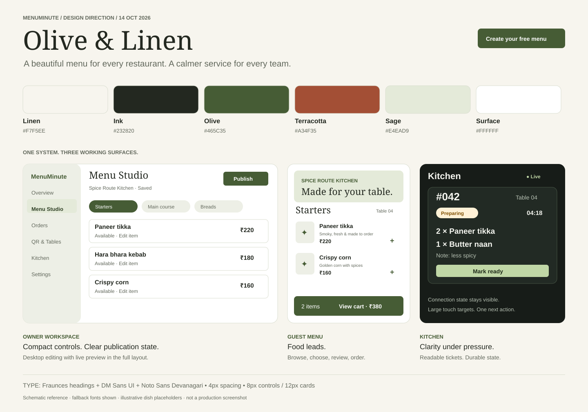

# MenuMinute — Olive & Linen design system

Baseline: 14 October 2026. This is the target for the next implementation phase. Current application code still uses orange and Inter; this documentation PR does not reskin it.

## 1. Visual approach

Warm hospitality in the public brand; precise controls in restaurant operations. Choose **Olive & Linen** as the proposed baseline, using the compactness of the previously discussed Paper & Plate direction and Nova-inspired shadcn components.

Food photography provides the richness. Linen space, olive actions, editorial headings and restrained rules provide the structure. Avoid heavy gradients, glass panels, decorative dashboards, floating emoji icons and motion that competes with a task. Terracotta adds warmth to illustrations and editorial details; it is not a second primary button color.

Use one component system with four surface treatments:

| Surface         | Composition and hierarchy                                                                                                                               |
| --------------- | ------------------------------------------------------------------------------------------------------------------------------------------------------- |
| Marketing       | Editorial hero, real product proof, clear free-versus-paid explanation, menu demo, one primary CTA: Create your free menu                               |
| Guest menu      | Restaurant identity first; sticky categories/search, compact photo-and-text dish rows, explicit variants, persistent cart only when ordering is enabled |
| Owner workspace | Stable navigation, compact tables/lists, prominent Menu Studio, contextual save/publish actions, desktop preview alongside the editor                   |
| Kitchen         | Dedicated charcoal surface, large ticket numbers/table labels, elapsed times, readable quantities, clear next action, connection status always visible  |

Restaurant themes can customize guest-facing logo, cover and validated accent presets. They must not recolor owner/kitchen workflows or order statuses. Ship one excellent guest template first; add variants after the core journey is validated.

## 2. Canonical colors

Use semantic CSS variables and foreground pairs. Hex values below are authoritative sRGB references; conversion to OKLCH must preserve the rendered color. Do not use raw `orange-*` or `stone-*` utilities as product semantics.

| Token                                       | Light value           | Purpose                             |
| ------------------------------------------- | --------------------- | ----------------------------------- |
| `background`                                | `#F7F5EE`             | Linen page canvas                   |
| `foreground`                                | `#232820`             | Main text                           |
| `card`, `popover`                           | `#FFFFFF`             | Reading and editing surfaces        |
| `card-foreground`, `popover-foreground`     | `#232820`             | Surface text                        |
| `primary`                                   | `#465C35`             | Olive actions and active navigation |
| `primary-foreground`                        | `#FFFFFF`             | Text on olive                       |
| `primary-hover`                             | `#374A29`             | Hover/pressed olive                 |
| `secondary`, `muted`                        | `#EDEFE6`             | Quiet supporting surfaces           |
| `secondary-foreground`, `accent-foreground` | `#2F4025`             | Secondary controls                  |
| `muted-foreground`                          | `#62685C`             | Supporting readable text            |
| `accent`                                    | `#E4EAD9`             | Hover and selected backgrounds      |
| `brand-warm`                                | `#A34F35`             | Terracotta editorial accents        |
| `brand-warm-foreground`                     | `#FFFFFF`             | Text on terracotta                  |
| `border`                                    | `#D9DDCF`             | Decorative dividers                 |
| `input`                                     | `#828A78`             | Form boundaries                     |
| `ring`                                      | `#465C35`             | Visible keyboard focus              |
| `destructive`                               | `#B42318`             | Destructive actions/errors          |
| `destructive-foreground`                    | `#FFFFFF`             | Text on destructive                 |
| `success` / foreground                      | `#E7F2E8` / `#24613A` | Success and ready state             |
| `warning` / foreground                      | `#FFF1D6` / `#805000` | Attention and preparation           |
| `info` / foreground                         | `#E8EFF8` / `#24558B` | Informational state                 |

Light border is decorative; use `input` or another verified 3:1 boundary where a control relies on its outline. Do not assume every pair in the palette is accessible at every opacity.

### Kitchen overrides

| Token                                                 | Value     |
| ----------------------------------------------------- | --------- |
| `background`                                          | `#171C18` |
| `card`, `popover`                                     | `#222A24` |
| `foreground`, `card-foreground`, `popover-foreground` | `#F4F5EF` |
| `muted`, `secondary`, `accent`                        | `#303A31` |
| `muted-foreground`                                    | `#B6C0B2` |
| `secondary-foreground`, `accent-foreground`           | `#F4F5EF` |
| `border`                                              | `#465344` |
| `input`                                               | `#7F9178` |
| `primary`, `ring`                                     | `#C0D7A6` |
| `primary-foreground`                                  | `#1F2B19` |
| `primary-hover`                                       | `#D1E3BD` |

Scope kitchen overrides to its shell. Marketing and guest templates default to light until a complete dark theme is verified; do not let device preference partially invert a hard-coded page. Staff appearance can later be an explicit preference.

Order status semantics use labels and icons as well as color: New/info, Accepted/neutral, Preparing/warning, Ready/success, Served/muted, Cancelled/destructive. Overdue is a separate attention flag, not an invented lifecycle state.

## 3. Typography

| Role       | Family / weights                   | Scale and use                                                    |
| ---------- | ---------------------------------- | ---------------------------------------------------------------- |
| Editorial  | Fraunces 500, 600                  | Marketing display 40–64px; guest section titles 24–32px          |
| Interface  | DM Sans 400, 500, 600, 700         | Body 16/24px; controls 14/20px; labels 13/18px                   |
| Kitchen    | DM Sans 500, 600, 700              | Item text 18–20px; table/ticket heading 24–32px                  |
| Devanagari | Noto Sans Devanagari 400, 500, 600 | Hindi content with matching visual size and generous line height |
| Numbers    | DM Sans, tabular numerals          | Prices, quantities, ticket timers                                |

Use Fraunces sparingly; forms, navigation, prices and kitchen content remain sans serif. Do not uppercase long labels. Load only used weights/scripts via build-time or bundled self-hosted fonts with swap and system fallbacks; avoid a font dependency that blocks menu rendering. Localize content, currency formatting and language labels independently. Language support is not a promise to generate unreviewed translations.

## 4. Geometry, density and motion

- Spacing: 4px base; common steps 4, 8, 12, 16, 24, 32, 48, 64.
- Radius: 6px small, 8px controls, 12px cards, 16px dialogs, 24px editorial feature panels; pills only for chips/status.
- Controls: 44px default touch height; 48–56px kitchen actions; icons 16/20/24px with consistent Lucide stroke treatment.
- Desktop navigation: approximately 232px; content max 1280px; readable prose max 68 characters.
- Guest menu: centered 720px maximum with 16px mobile gutters; dish images reserve a stable aspect ratio.
- Menu Studio: category rail about 200px, flexible item list and 360px preview when width permits; below 1024px use Edit/Preview tabs.
- Kitchen board: responsive 1–4 columns with minimum 280px ticket widths. Avoid horizontal ticket overflow; keep completed work in a separate view.
- Elevation: border first; light shadow on floating controls, stronger only for dialogs/sheets. No shadow on every row.
- Motion: 120–180ms for controls, up to 240ms for a sheet; opacity/transform only where useful. Respect reduced motion; no auto-playing hero or essential animated instructions.

## 5. shadcn implementation contract

Use Nova-inspired shadcn primitives with the repo's existing Radix foundation. Add `src/components/ui` and `components.json` in the implementation phase; do not claim the repository is already configured for a Nova preset. Verify current CLI/preset compatibility before generating components.

Define raw values in `:root` and scoped overrides; map them through Tailwind v4 `@theme inline`. Components consume `bg-background`, `text-foreground`, `bg-primary`, `border-border` and related semantic utilities. Alias legacy brand tokens temporarily while migrating screens, then remove them after visual checks.

Prioritize Button, Input, Label, Textarea, Select, Dialog, Sheet, Tabs, DropdownMenu, Tooltip, Badge, Table, Skeleton, Alert and Toast. Build shared DishRow, AvailabilitySwitch, Money, OrderStatusBadge, ConnectionBanner, EmptyState and KitchenTicket on those primitives.

Use a Sheet for mobile item configuration/cart, a Dialog for focused desktop decisions and inline errors near fields. Toasts supplement durable saved/error states. Destructive actions clearly name the item affected. Disabled actions explain why. Keyboard alternatives accompany drag-to-reorder.

## 6. Screen contracts and acceptance

Guest rows show name, reviewed dietary indicator, short description, price and optional image. Never imply allergen safety from an AI label. Required options must be explicit before adding. The cart includes itemized price, taxes/fees if configured, and final payable total before submission.

Owner navigation: Overview, Menu Studio, Orders, QR & Tables, Kitchen, Settings & Plan. Hide irrelevant controls for staff roles. Upgrade prompts appear at feature entry, never during free menu publication.

Kitchen tickets show number, table, time, item quantities, variants, preparation notes and one clear next action. Update only after server acknowledgment. Keep pending actions visible, avoid ticket reflow while a user is interacting, and show failed/retry states inline.

Verify 360, 390, 768, 1024 and 1440px layouts; text zoom to 200%; keyboard-only operation; reduced motion; long dish names; Hindi labels; empty/missing images; network failure; and safe areas with a bottom cart.

Acceptance target: WCAG 2.2 AA; text contrast at least 4.5:1 for ordinary text, 3:1 for large text and required non-text boundaries. Validate actual component states, not palette swatches alone. No clipped controls, focus hidden by sticky elements, color-only status or deceptive success states.

The direction board is a schematic visual reference with fallback fonts. It is not a production screenshot or proof of font/layout acceptance.

## 7. Alternatives and why this baseline

The starter's orange/Inter direction is recognizable but gives MenuMinute less distinctive hospitality character. Paper & Plate's restrained operational layout remains useful for dense screens. Olive & Linen combines that discipline with an editorial public identity, while allowing each restaurant's food and branding to lead.

Reference: [shadcn semantic theming](https://ui.shadcn.com/docs/theming), checked 14 October 2026.
