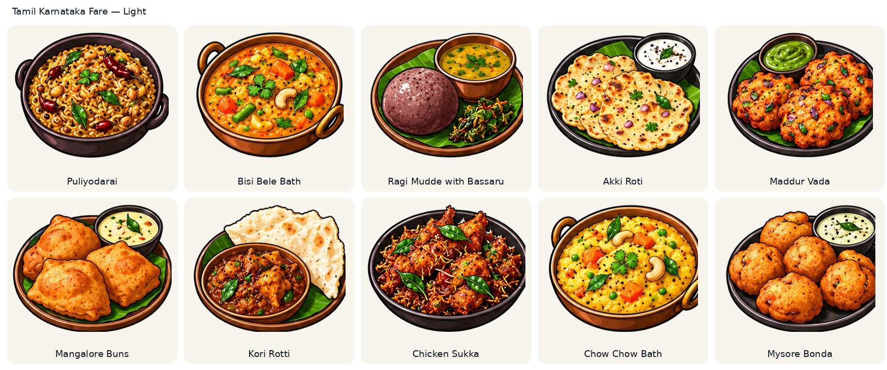
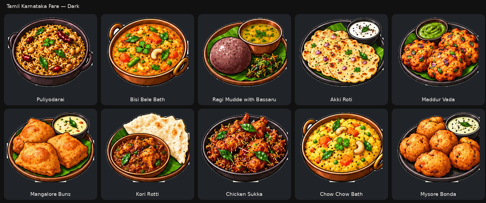
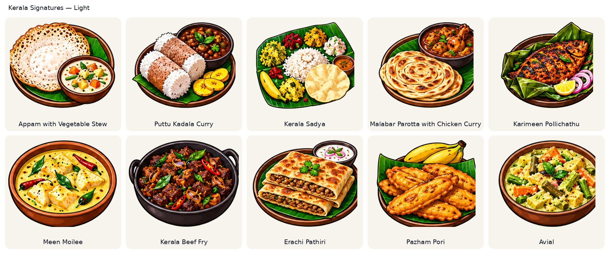
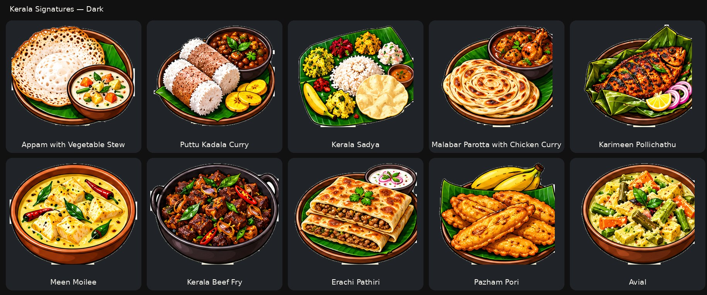
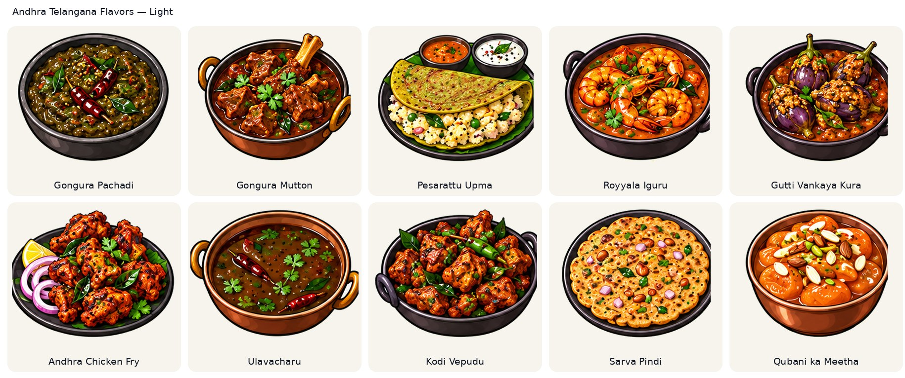
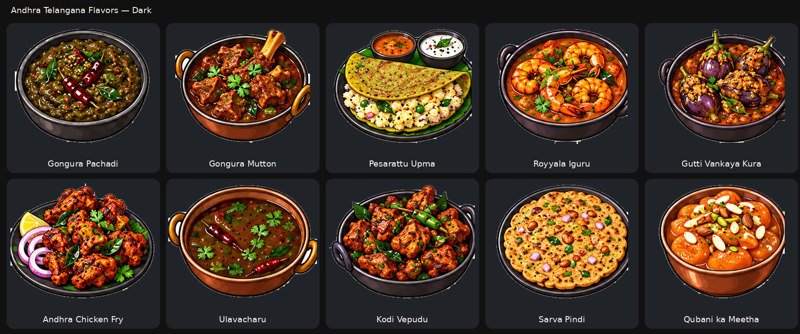
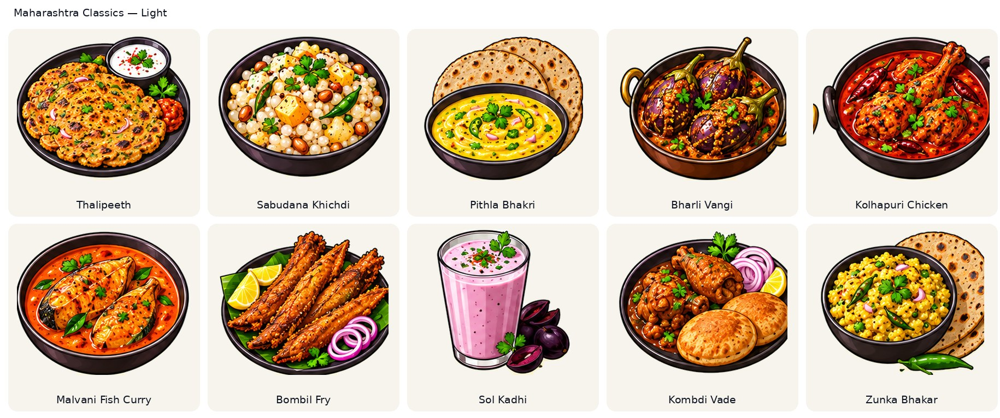
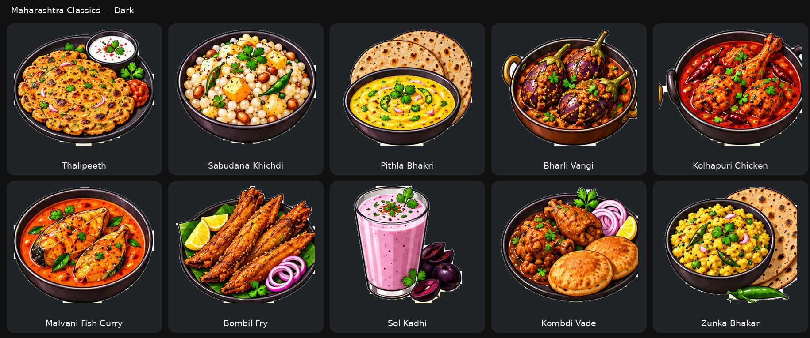
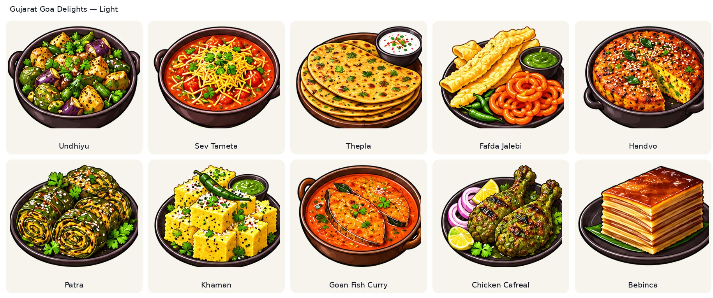
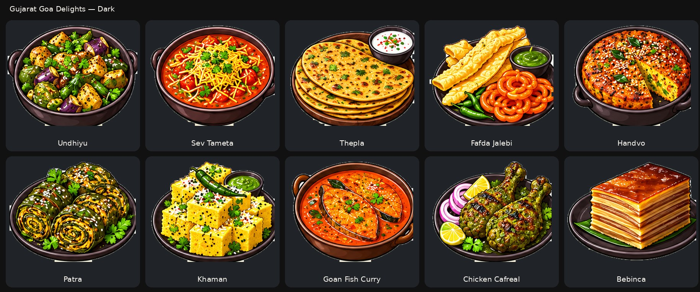

# Dish illustration gallery

36 original illustrations plus 50 new review-batch illustrations (86 total), individually separated as transparent 360 × 280 PNGs. The new 50 are awaiting owner visual sign-off.

Review the package's light and dark contact sheets before approving integration.

## Indian dishes

### Biryani

### Butter Chicken

### Masala Dosa

### Idli Sambar

### Paneer Tikka

### Samosa

### Chole Bhature

### Rajma Chawal

### Naan

### Dal Tadka

### Vada Pav

### Gulab Jamun

## Western dishes

### Burger

### Steak

### Sandwich

### Caesar Salad

### Fried Chicken

### French Fries

### Pancakes

### Hot Dog

### Mac & Cheese

### Grilled Fish

### Donut

### Milkshake

## Italian dishes

### Pizza Margherita

### Spaghetti

### Penne Alfredo

### Lasagna

### Risotto

### Ravioli

### Bruschetta

### Gnocchi

### Caprese Salad

### Focaccia

### Tiramisu

### Gelato

## North Indian Classics — new review batch

### Dal Makhani

### Palak Paneer

### Kadai Paneer

### Shahi Paneer

### Tandoori Chicken

### Chicken Tikka

### Malai Kofta

### Aloo Paratha

### Pindi Chole

### Lassi

## Street Food Snacks — new review batch

### Pav Bhaji

### Dabeli

### Pani Puri

### Bhel Puri

### Ragda Pattice

### Poha

### Misal Pav

### Kachori

### Dhokla

### Khandvi

## South Coastal Specials — new review batch

### Medu Vada

### Uttapam

### Ven Pongal

### Appam with Stew

### Puttu Kadala

### Kerala Parotta

### Hyderabadi Haleem

### Chettinad Chicken

### Fish Curry Rice

### Pesarattu

## East Northeast Specials — new review batch

### Litti Chokha

### Macher Jhol

### Kosha Mangsho

### Pakhala Bhata

### Dhuska

### Aloo Pitika

### Jadoh

### Smoked Pork with Bamboo Shoot

### Momos

### Thukpa

## Indo Chinese Starters — new review batch

### Chilli Paneer Dry

### Gobi Manchurian

### Chicken Lollipop

### Veg Spring Rolls

### Honey Chilli Potato

### Crispy Corn

### Veg Manchurian Dry

### Dragon Chicken

### Paneer 65

### Schezwan Momos

---

## Second generated 50 — awaiting owner review

The 50 below are canonical 360×280 transparent PNGs; the light/dark sheets show the same PNG composited onto both surfaces. The artwork labels do not all correspond to the same sequential rows of the separate India-200 backlog. Only exact matches are linked by `datasetId` in the manifest.

### Tamil & Karnataka Fare — 10 artworks

**Light theme proof**

**Dark theme proof**

#### Puliyodarai

#### Bisi Bele Bath

#### Ragi Mudde with Bassaru

#### Akki Roti

#### Maddur Vada

#### Mangalore Buns

#### Kori Rotti

#### Chicken Sukka

#### Chow Chow Bath

#### Mysore Bonda

### Kerala Signatures — 10 artworks

**Light theme proof**

**Dark theme proof**

#### Appam with Vegetable Stew

#### Puttu Kadala Curry

#### Kerala Sadya

#### Malabar Parotta with Chicken Curry

#### Karimeen Pollichathu

#### Meen Moilee

#### Kerala Beef Fry

#### Erachi Pathiri

#### Pazham Pori

#### Avial

### Andhra & Telangana Flavors — 10 artworks

**Light theme proof**

**Dark theme proof**

#### Gongura Pachadi

#### Gongura Mutton

#### Pesarattu Upma

#### Royyala Iguru

#### Gutti Vankaya Kura

#### Andhra Chicken Fry

#### Ulavacharu

#### Kodi Vepudu

#### Sarva Pindi

#### Qubani ka Meetha

### Maharashtra Classics — 10 artworks

**Light theme proof**

**Dark theme proof**

#### Thalipeeth

#### Sabudana Khichdi

#### Pithla Bhakri

#### Bharli Vangi

#### Kolhapuri Chicken

#### Malvani Fish Curry

#### Bombil Fry

#### Sol Kadhi

#### Kombdi Vade

#### Zunka Bhakar

### Gujarat & Goa Delights — 10 artworks

**Light theme proof**

**Dark theme proof**

#### Undhiyu

#### Sev Tameta

#### Thepla

#### Fafda Jalebi

#### Handvo

#### Patra

#### Khaman

#### Goan Fish Curry

#### Chicken Cafreal

#### Bebinca

