# Menu-Minute dish illustration gallery

**224 individually named transparent 360 × 280 RGBA PNG illustrations.** 186 earlier assets are retained, plus 38 unique dish cutouts from Sheets A–D (40 displayed cells, two repeated across A/B). These are raster assets, **not native editable SVG vectors**. Owner approval is required prior to runtime integration.

Shared across light/dark themes. [Manifest](manifest.json) · [README](README.md). Sheet A's Veg Hakka Noodles and Chicken Fried Rice refer to Sheet B's canonical versions.

## Indian dishes (12)

### Biryani

### Butter Chicken

### Masala Dosa

### Idli Sambar

### Paneer Tikka

### Samosa

### Chole Bhature

### Rajma Chawal

### Naan

### Dal Tadka

### Vada Pav

### Gulab Jamun

## Western dishes (12)

### Burger

### Steak

### Sandwich

### Caesar Salad

### Fried Chicken

### French Fries

### Pancakes

### Hot Dog

### Mac & Cheese

### Grilled Fish

### Donut

### Milkshake

## Italian dishes (12)

### Pizza Margherita

### Spaghetti

### Penne Alfredo

### Lasagna

### Risotto

### Ravioli

### Bruschetta

### Gnocchi

### Caprese Salad

### Focaccia

### Tiramisu

### Gelato

## North Indian Classics (10)

### Dal Makhani

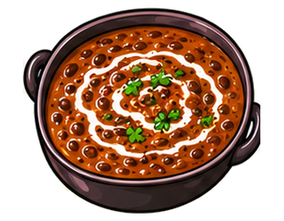

### Palak Paneer

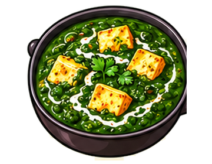

### Kadai Paneer

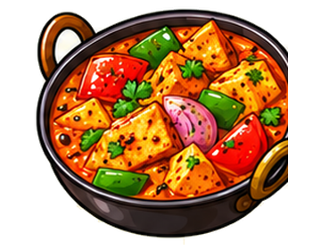

### Shahi Paneer

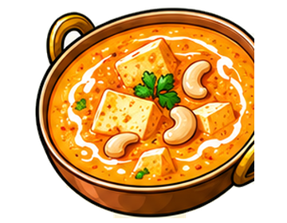

### Tandoori Chicken

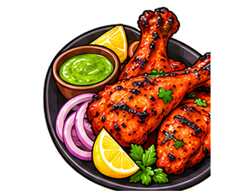

### Chicken Tikka

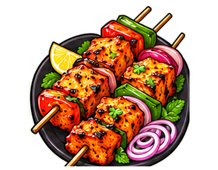

### Malai Kofta

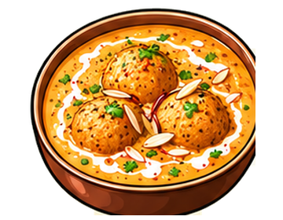

### Aloo Paratha

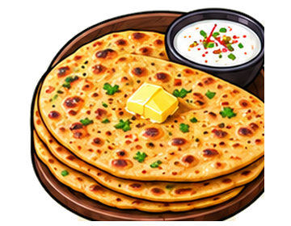

### Pindi Chole

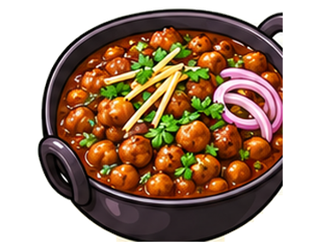

### Lassi

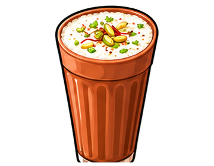

## Street Food Snacks (10)

### Pav Bhaji

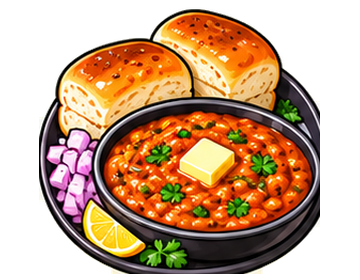

### Dabeli

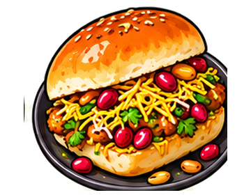

### Pani Puri

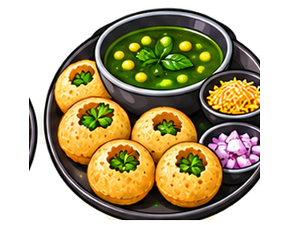

### Bhel Puri

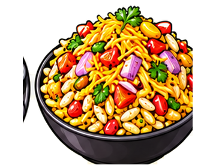

### Ragda Pattice

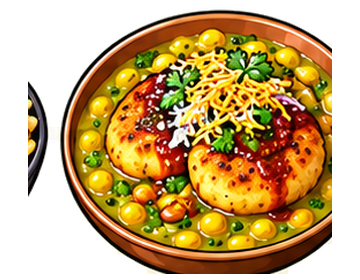

### Poha

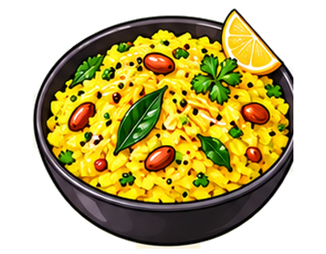

### Misal Pav

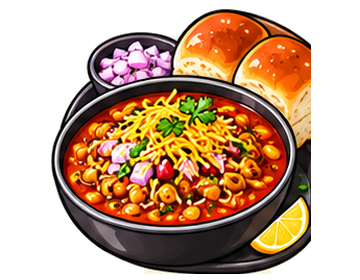

### Kachori

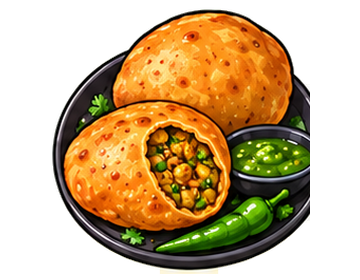

### Dhokla

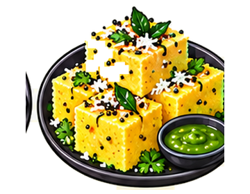

### Khandvi

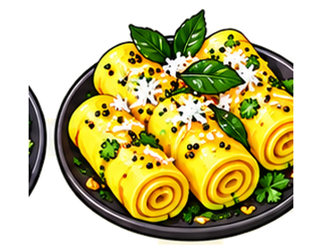

## South Coastal Specials (10)

### Medu Vada

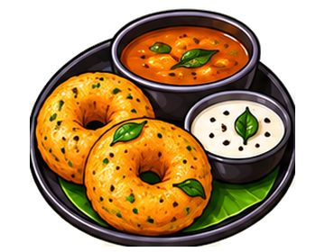

### Uttapam

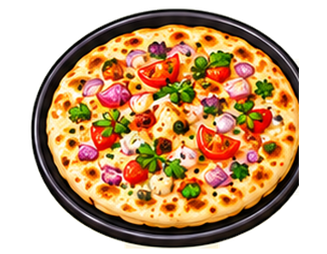

### Ven Pongal

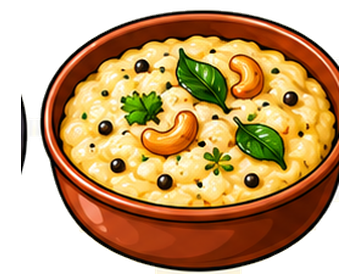

### Appam with Stew

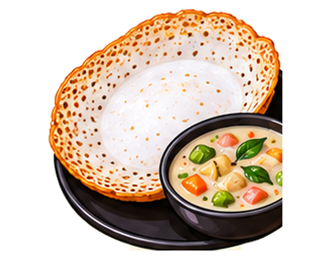

### Puttu Kadala

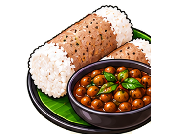

### Kerala Parotta

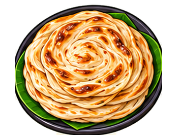

### Hyderabadi Haleem

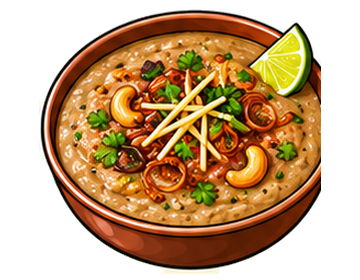

### Chettinad Chicken

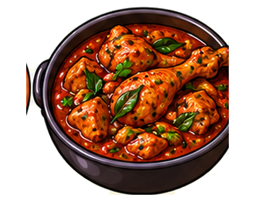

### Fish Curry Rice

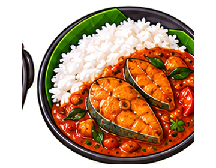

### Pesarattu

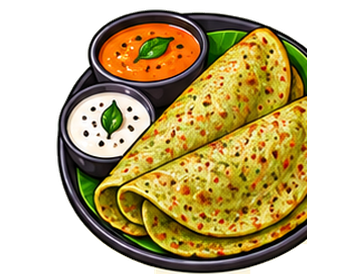

## East Northeast Specials (10)

### Litti Chokha

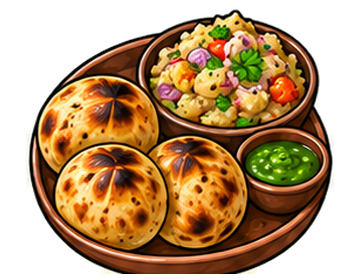

### Macher Jhol

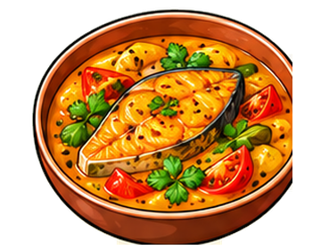

### Kosha Mangsho

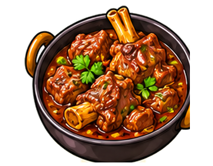

### Pakhala Bhata

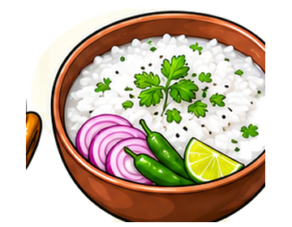

### Dhuska

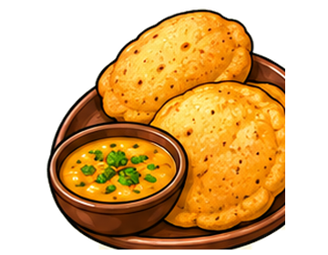

### Aloo Pitika

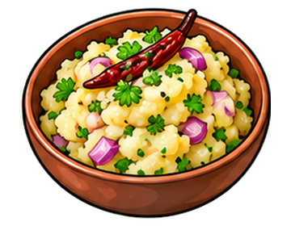

### Jadoh

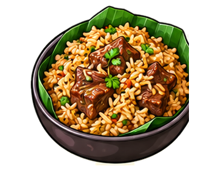

### Smoked Pork with Bamboo Shoot

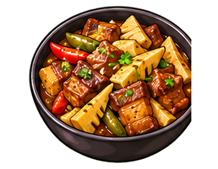

### Momos

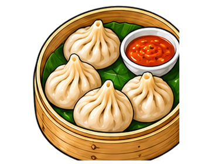

### Thukpa

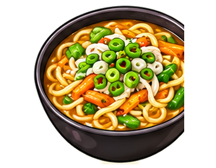

## Indo Chinese Starters (10)

### Chilli Paneer Dry

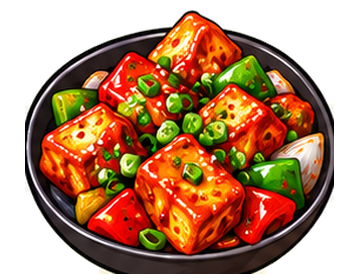

### Gobi Manchurian

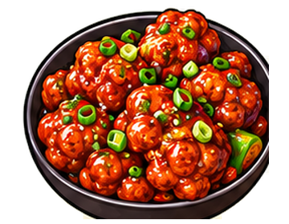

### Chicken Lollipop

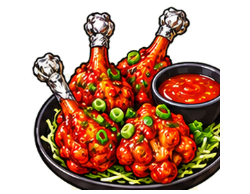

### Veg Spring Rolls

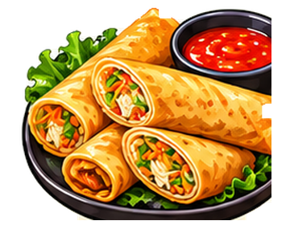

### Honey Chilli Potato

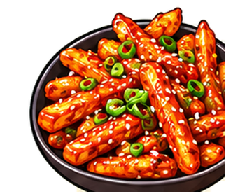

### Crispy Corn

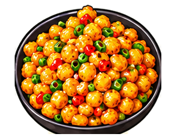

### Veg Manchurian Dry

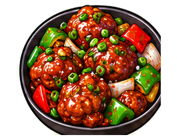

### Dragon Chicken

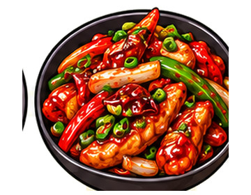

### Paneer 65

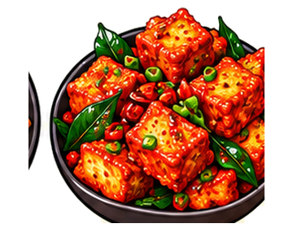

### Schezwan Momos

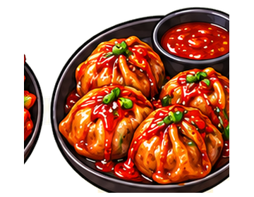

## Tamil Karnataka Fare (10)

### Puliyodarai

### Bisi Bele Bath

### Ragi Mudde with Bassaru

### Akki Roti

### Maddur Vada

### Mangalore Buns

### Kori Rotti

### Chicken Sukka

### Chow Chow Bath

### Mysore Bonda

## Kerala Signatures (10)

### Appam with Vegetable Stew

### Puttu Kadala Curry

### Kerala Sadya

### Malabar Parotta with Chicken Curry

### Karimeen Pollichathu

### Meen Moilee

### Kerala Beef Fry

### Erachi Pathiri

### Pazham Pori

### Avial

## Andhra Telangana Flavors (10)

### Gongura Pachadi

### Gongura Mutton

### Pesarattu Upma

### Royyala Iguru

### Gutti Vankaya Kura

### Andhra Chicken Fry

### Ulavacharu

### Kodi Vepudu

### Sarva Pindi

### Qubani ka Meetha

## Maharashtra Classics (10)

### Thalipeeth

### Sabudana Khichdi

### Pithla Bhakri

### Bharli Vangi

### Kolhapuri Chicken

### Malvani Fish Curry

### Bombil Fry

### Sol Kadhi

### Kombdi Vade

### Zunka Bhakar

## Gujarat Goa Delights (10)

### Undhiyu

### Sev Tameta

### Thepla

### Fafda Jalebi

### Handvo

### Patra

### Khaman

### Goan Fish Curry

### Chicken Cafreal

### Bebinca

## Bengal Odisha Delights (10)

### Shorshe Ilish

### Chingri Malai Curry

### Aloo Posto

### Luchi Aloor Dom

### Macher Paturi

### Mishti Pulao

### Dalma

### Santula

### Chenna Tarkari

### Chhena Poda

## Bihar Jharkhand Classics (10)

### Sattu Paratha

### Champaran Mutton

### Dal Pitha

### Ghugni

### Thekua

### Makhana Kheer

### Rugra Curry

### Kadhi Bari

### Chilka Roti

### Tilkut

## Northeast Treasures (10)

### Masor Tenga

### Khar

### Bai

### Tungrymbai

### Dohneiiong

### Eromba

### Singju

### Smoked Pork with Axone

### Chak Hao Kheer

### Duck with Bamboo Shoot

## Himalayan Comforts (10)

### Thenthuk

### Tingmo with Shapta

### Sha Phaley

### Gyathuk

### Phagshapa

### Sel Roti

### Gundruk Soup

### Kinema Curry

### Chhurpi Soup

### Yomari

## Indo Chinese Starters Ii (10)

### Chilli Chicken Dry

### Chilli Mushroom

### Baby Corn Manchurian

### Salt & Pepper Corn

### Crispy Chilli Baby Corn

### Drums of Heaven

### Hot Garlic Paneer

### Pan Fried Momos

### Schezwan Chicken Wings

### Crispy Spinach Corn

## Sheet A — High-Demand Essentials (8)

[Light preview](previews/sheets-abcd/preview-high-demand-essentials-light.jpg) · [Dark preview](previews/sheets-abcd/preview-high-demand-essentials-dark.jpg)

### Chicken Biryani

### Plain Veg Dosa

### Chicken Kathi Roll

### Chicken Nuggets

### White Chocolate Cake

### Kaju Katli

### Jalebi

### Rasmalai

## Sheet B — Indo-Chinese Mains & Soups (10)

[Light preview](previews/sheets-abcd/preview-indo-chinese-mains-soups-light.jpg) · [Dark preview](previews/sheets-abcd/preview-indo-chinese-mains-soups-dark.jpg)

### Veg Hakka Noodles

### Veg Schezwan Noodles

### Veg Schezwan Fried Rice

### Egg Fried Rice

### Chicken Fried Rice

### Veg Triple Schezwan Rice

### Veg American Chop Suey

### Chicken Chop Suey

### Veg Manchow Soup

### Chicken Hot and Sour Soup

## Sheet C — North Indian & Rajasthani (10)

[Light preview](previews/sheets-abcd/preview-north-indian-rajasthani-light.jpg) · [Dark preview](previews/sheets-abcd/preview-north-indian-rajasthani-dark.jpg)

### Amritsari Kulcha

### Makki di Roti & Sarson da Saag

### Rogan Josh

### Galouti Kebab

### Lucknowi Nihari

### Dal Baati Churma

### Gatte Ki Sabzi

### Laal Maas

### Pyaaz Kachori

### Mirchi Vada

## Sheet D — Regional Restaurant Favorites (10)

[Light preview](previews/sheets-abcd/preview-regional-restaurant-favorites-light.jpg) · [Dark preview](previews/sheets-abcd/preview-regional-restaurant-favorites-dark.jpg)

### Vegetable Kothu Parotta

### Parotta With Salna

### Kuzhi Paniyaram

### Curd Rice

### Lemon Rice

### Bagara Baingan

### Mirchi Ka Salan

### Kothimbir Vadi

### Dal Dhokli

### Prawn Balchao

