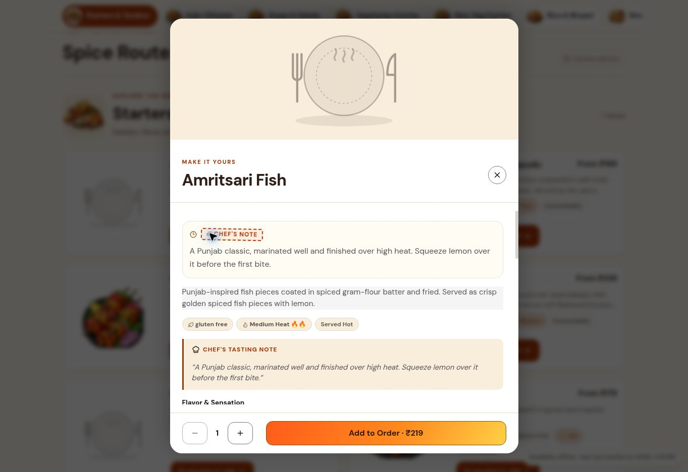
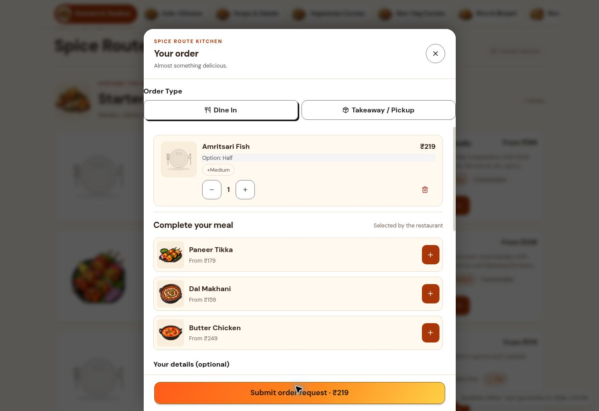

# Diner journey polish

Work package: [#329](https://github.com/baba-dev/menuminute/issues/329).

## Current browser evidence

Captured on 6 November 2026 from the public Spice Route Kitchen demo. The browser exposed a
1363 × 936 desktop viewport and no supported viewport resize control. These screenshots are
baseline evidence, not mobile screenshots or proof of the patched rendering.

1. Menu browsing and opening a dish worked. No production order was submitted.
2. The customizer repeated the same chef note twice before the required choices. Its close
   control was 36px. The photo occupied non-scrolling sheet space.
3. Adding an item and opening the cart worked. Removing its final item removed the dialog but
   left `document.body.style.overflow` equal to `hidden`, preventing normal page scrolling.
4. Submission, restaurant acceptance, and tracking were not exercised on production.

## Changes

- Tie the cart scroll lock to a visible, non-empty dialog. Removing or decrementing the final
  item closes the cart so a later addition starts with the normal cart bar.
- Keep one chef note, move the photo into the scrollable body, provide a 44px close control,
  and associate the special-instructions label with its field.
- Keep sheet headers and footers from shrinking. Below 450px, reduce horizontal padding,
  stack the add action below quantity, use smaller cart thumbnails and readable form text.
- Let long cart item names wrap and increase suggestion buttons to 44px. Preserve safe-area
  padding, existing theme tokens, and the cart alignment delivered in #323.

## Verification and remaining acceptance

- Three isolated component regressions passed; all three fail against the original cart with
  the expected stuck-scroll assertion. Tests cover remove, decrement, external clear, and re-open.
- Changed component ESLint passed. Formatting and whitespace checks are included in the handoff.
- Added 360px and 390px browser cases to the existing isolated ordering fixture. They verify
  touch-target geometry, labelled instructions, viewport-contained actions, cart overflow,
  scroll recovery and a fresh cart. They also capture screenshots for CI artifacts.
- Full repository typecheck, production build and browser cases require final CI evidence.
  Local validation reused an available dependency tree; a concurrent dependency resolution
  and external node_modules symlink prevented reliable full build/typecheck results. No
  dependency or lockfile changes are part of this patch.
- Before merge, review the CI screenshots and check iOS keyboard/zoom, Android keyboard,
  landscape/short screens, dark mode and long translated names on real devices.

No migration or server contract change. Prices, tax quoting, idempotency, contact consent and
order acceptance are unchanged. Roll back by reverting the UI commit; no data rollback is needed.
